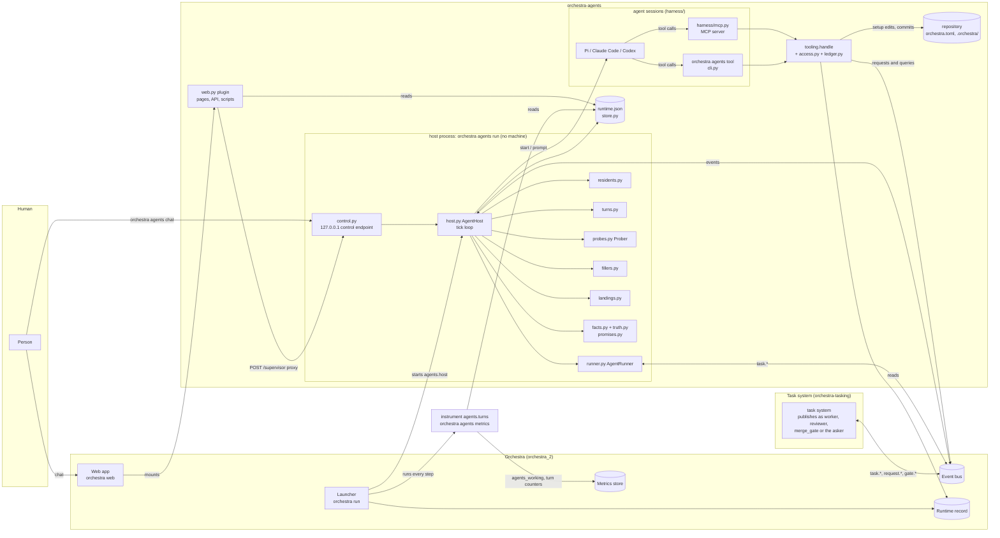
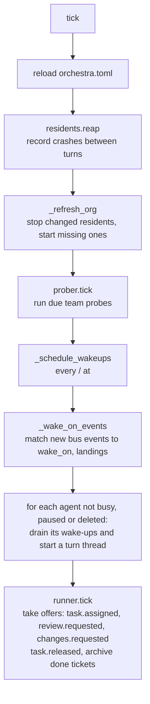
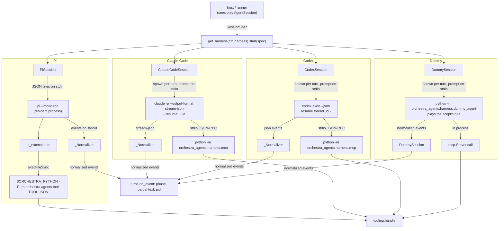

# orchestra-agents: architecture

This document explains how orchestra-agents works, for the owner and for engineers new to the
code. It describes the code on `main` at `91ce6dd`, with the role checks of `access.py` added since. Every module is named by its path under
`orchestra_agents/`. `SPEC.md` is the design and `AGENTS.md` holds the rules. This document
explains the code and does not replace either of them.

Contents:

1. [What it is](#1-what-it-is)
2. [The parts](#2-the-parts)
3. [How it plugs into Orchestra](#3-how-it-plugs-into-orchestra)
4. [The host and its control endpoint](#4-the-host-and-its-control-endpoint)
5. [The organisation: roles, agents, teams](#5-the-organisation-roles-agents-teams)
6. [Harnesses and sessions](#6-harnesses-and-sessions)
7. [Resident agents and wake-ups](#7-resident-agents-and-wake-ups)
8. [Filling the task system's roles: the runner](#8-filling-the-task-systems-roles-the-runner)
9. [The tools agents get](#9-the-tools-agents-get)
10. [The Supervisor as the human's operator](#10-the-supervisor-as-the-humans-operator)
11. [The Supervisor's facts and checks](#11-the-supervisors-facts-and-checks)
12. [How a human talks to it](#12-how-a-human-talks-to-it)
13. [Web panels and machine cards](#13-web-panels-and-machine-cards)
14. [Metrics](#14-metrics)
15. [Events: the full contract](#15-events-the-full-contract)
16. [Settings and state](#16-settings-and-state)
17. [Extending it: a custom role, a harness](#17-extending-it-a-custom-role-a-harness)
18. [Limits worth knowing](#18-limits-worth-knowing)

---

## 1. What it is

orchestra agents runs AI agents as Orchestra machines. It is an Orchestra plugin, and it also
has a long-running process of its own, the **host**.

What the plugin is (the owner, 2026-10-27): a target repository usually defines its own machines,
as programs that publish and listen on the bus under their own `source`, or through a bridge that
relays another system's actors. The Agents plugin is a common resource for the same thing:

- an **implementation of a machine**, the AI agent (a universal machine: its role's prompt and
  tools decide what it does);
- the **means to configure one**: roles, the harness and model, how it is engaged (resident,
  scheduled, ad hoc, its `wake_on`), and its permissions (tool groups, access, team);
- a **shared runtime** that runs the configured agents, the host, which is **no machine**: it
  never announces itself, never publishes as `agents` and writes no metrics, and acts on the bus
  only as the agents it runs;
- **UI additions**: the Agents page, transcripts, the Supervisor chat, the machine cards.

The machines are the configured agents. The plugin that provides them is never one.

- The host keeps the **resident agents** up: the Supervisor (the human's one point of
  contact), the Coordinator (keeps the plan executable), and any custom agent.
- It wakes agents on the bus events they listen for, on their schedules, and on notes from
  other agents.
- When a task system (orchestra-tasking) offers a ticket to the `worker` or `reviewer` role,
  the host can fill that role. It starts one agent session for that ticket.
- The **harness** setting picks which product runs a session: Pi, Claude Code or Codex, or
  `dummy`, scripted agents with no model and no cost for demos and tests. Only the code under
  `harness/` knows which one is in use.
- The plugin adds the Agents page, the Supervisor chat, an attention banner and the agents'
  machine cards to Orchestra's web UI.

The guarantees we care about, and where each one comes from:

| What we care about | How the code delivers it |
|---|---|
| Agents are machines Orchestra can see | Every event goes on Orchestra's bus as a CloudEvent, with the agent's instance (`supervisor`, `worker/1`) as `source` (`events.py`). Each instance announces itself with `orchestra.machine.started` (`host.py` `_announce`), listing what the host watches on its behalf (`listening.py`). |
| The host is no machine | `events.py` refuses a publish as `agents` or with no source; the host announces nothing of its own, the plugin declares no machine for it, and its measurements reach the store through the plugin's instrument (`measures.py`, `web.collectors`). `tests/unit/test_host_is_no_machine.py` fails otherwise. |
| The agents never change a ticket directly | Ticket and milestone tools are requests on the bus, and the task system applies them (`protocol.py` `TaskClient`). Nothing imports `tasking`. |
| No branching or worktree management | The task system names the workspace in the offer. The runner only runs a session in it (`runner.py`). |
| A lost race costs nothing | The runner starts a session only after it has read its claim back from the bus as the first valid claim of the offer (`runner.py` `_held`): the bus's order decides, and the task system confirms nothing. |
| No orphan processes | Each turn's pid is recorded on its session. A new host kills orphans on start (`host.py` `recover`). Shutdown closes turns, waits for their reports, then closes the residents, all inside the stop grace (`host.py` `run`, `closing.py`, `web.py` `STOP_GRACE_S`). |
| Bounded context | Each session's context is measured in tokens from the harness's own transcript. Past the limit the session is compacted or rotated (`residents.py` `trim_if_large`). |
| The human talks only to the Supervisor | The UI and CLI only read. The one write is the chat (`web.py` `POST /supervisor`, `control.py`). |
| The Supervisor fixes the setup, not the code | Its setup tools change the configuration one entry at a time, through Orchestra's `config_edit`, in `orchestra.toml` (committed with a reason) or the owner's private overlay (never committed), and announce it on the bus (`setup_tools.py`, `config_change.py`). There is no code-writing tool. |
| The Supervisor's replies are true | The tool calls are recorded in a ledger, the facts go in front of each turn, and Orchestra appends a correction when a reply contradicts them (`ledger.py`, `facts.py`, `truth.py`, `promises.py`). |
| One transcript | The harness's own session file is the only transcript. The host keeps markers beside it and never writes a parallel log (`store.py` `add_marker`, `web.py` transcript view). |

---

## 2. The parts



The modules, grouped by job:

| Job | Modules |
|---|---|
| Entry points | `cli.py` (`orchestra agents …`, the entry point `orchestra.commands: agents`; no executable of its own), `__main__.py`, `web.py` (`plugin`, the entry point `orchestra.plugins: agents`) |
| The host | `host.py`, `residents.py`, `turns.py`, `runner.py`, `control.py`, `closing.py`, `clock.py`, `probes.py`, `fillers.py`, `landings.py`, `verdicts.py` |
| Harnesses | `harness/base.py`, `harness/pi.py`, `harness/pi_extension.ts`, `harness/claude_code.py`, `harness/codex.py`, `harness/dummy.py`, `harness/dummy_agent.py`, `harness/dummy_script.py`, `harness/dummy_defaults.toml`, `harness/mcp.py`, `harness/tools.py`, `harness/__init__.py` |
| Tools | `tooling.py`, `access.py`, `api_org.py`, `ledger.py`, `observe.py`, `observe_model.py`, `setup_tools.py`, `config_change.py`, `restart.py`, `gate_busy.py`, `secret_shapes.py`, `modeling.py`, `model_text.py`, `run_text.py` |
| The Supervisor's honesty checks | `promises.py`, `facts.py`, `truth.py`, `ledger.py` |
| Organisation | `builtins.py`, `roles.py`, `org.py`, `org_store.py`, `org_views.py`, `prompting.py`, `prompts/` |
| Contract with the task system | `protocol.py` |
| Bus, state, settings, metrics | `events.py`, `store.py`, `config.py`, `measures.py`, `listening.py` |
| UI | `static/agents.html`, `static/agents.js`, `static/agents.css`, `static/attention.js`, `static/machine-cards.js`, `static/ticket-sessions.js` |
| What the UI reads of transcripts | `session_turns.py` (a transcript as turns; the turns on a ticket), `attention.py` (the Supervisor's unread message) |

---

## 3. How it plugs into Orchestra

The package registers an Orchestra plugin in `pyproject.toml`:

```toml
[project.entry-points."orchestra.plugins"]
agents = "orchestra_agents.web:plugin"
```

`web.plugin(orchestra_project)` returns an `orchestra.plugins.Plugin` with these parts:

| Part | Value | Source |
|---|---|---|
| Name | `agents` (API at `/api/plugins/agents`, static files at `/plugins/agents/static/`) | `web.plugin` |
| Pages | `/agents`, titled "Agents" (`static/agents.html`) | `web.plugin` |
| Scripts on every page | `attention.js`, `machine-cards.js`, `ticket-sessions.js` | `web.plugin` |
| Stylesheets on every page | `agents.css` | `web.plugin` |
| API router | see [section 13](#13-web-panels-and-machine-cards) | `web.router` |
| Declared machines | every agent from `org_store.all_agents` (kind `agent`, `continuous` if resident or `ad hoc`, and what it listens for, `listening.listens_for`). The host is not one. | `web.declared` |
| Processes | `host`: `[sys.executable, -m, orchestra, agents, run, --wait]` with `stop_grace_s=30`, **unless `[agents] enabled = false`** (no `[agents]` section is needed) | `web.processes` |
| Collectors | `turns` (Orchestra names it `agents.turns`): the command `orchestra agents metrics`, every discovery step, same condition | `web.collectors` |
| Guide | `orchestra_agents/guide.md`: the `[agents]` settings for the Supervisor (`orchestra.guides`) | `web.GUIDE` |
| Check | `web.check`: the `[agents]` reader, run by `config_edit` on every change | `web.check` |

So `orchestra run` starts the host as the process `agents.host`, keeps it running and stops it.
A project without `[agents]` runs it on the default harness (`config.default_harness`: Claude Code
with Haiku when `claude` is found, else dummy), and on a project not set up the Supervisor is woken
to set it up (`first_run.py`).

Declared machines only fill gaps on Orchestra's Machines page. What Orchestra shows comes from
what it observes on the bus (Orchestra rule 2).

The host uses Orchestra only as a library:

- the bus, through `orchestra.events.Events` (wrapped by `events.py`);
- the metrics store, through `orchestra.metrics.for_project`, to read only (`observe_model.py`):
  the agents' own measurements reach it through the instrument the plugin declares;
- the runtime record, through `orchestra.runtime` (`restart.py`, `observe.py`, `setup_tools.py`);
- the configuration, only through Orchestra's objects: `project.orchestra.config` to read it (the
  private overlay merged), `project.orchestra.config_edit` to change it (`config_change.py`,
  `restart.py`); `orchestra.collect.spec` reads the collectors from it (`observe.py`);
- the model view and log readers: `orchestra.web.dynamics.model_view` and
  `orchestra.web.machine_logs`.

---

## 4. The host and its control endpoint

`orchestra agents run` creates `host.AgentHost` and calls `run(wait=...)`. There is one host per
project. On the bus it is nobody: every event it sends is an agent's (`host._say`,
`host.source_of`), and it never announces itself.

### Start-up

1. **Take the project** (`_take_project`). If another live host's pid is in
   `runtime.json` `control`, or the control port cannot be bound, the host stops here. Without
   `--wait` it exits with status 1. With `--wait`, which is how the launcher starts it, it
   checks again every 2 s (`WAIT_RETRY_S`).
2. **Serve the control endpoint** (`_start_control`). This is a `ControlServer` on 127.0.0.1 at
   `[agents] control_port` (0 means any free port). The port and pid are recorded with
   `store.set_control`; the control token (`agents/control.token`, owner-only, `control.bearer`)
   is kept apart from the runtime record, which the Agents page reads.
3. **Recover** (`recover`). For each session left `running` with a pid, the host kills that
   process group (`_kill_orphan`). It marks the turn `session.interrupted` and sets the session
   to idle.
4. **Finish an interrupted restart.** `restart.recover` puts back a `[[machines]]` entry that an
   interrupted `restart_machine` took out ([section 10](#10-the-supervisor-as-the-humans-operator)).
5. **Load the organisation** (`_refresh_org`) and start the resident sessions
   (`Residents.start_missing`). Each session's agent announces itself as it opens (`_announce`).
   There is no announcement of the host's own and no metric point: the instrument reports every
   measured role at 0 until a turn starts.

### The tick (once a second)



- The config is re-read every tick. A change to `[agents]` takes effect within a second.
- Each agent gets at most one turn thread (`agent_threads`). One lock per agent
  (`_turn_lock`) keeps a wake-up and a chat turn from running on the same session at once.
- Per-ticket workers and reviewers are never woken. They only answer assignments.
- The Supervisor is not woken while it has no resident session.

### Shutdown

When the host gets SIGTERM or SIGINT:

1. Each running turn is marked `session.interrupted` with the reason "orchestra shut down".
2. Every per-ticket session that is mid-turn is closed together (`closing.close_together`, each
   close at most `CLOSE_S` = 5 s).
3. The host waits up to `SHUTDOWN_REPORTS_S` (10 s) for each open assignment's `task.reported`
   (`failed`) to go out. The contract has no release that a machine can send.
4. The resident sessions are closed together (5 s).
5. The control endpoint stops, and the control record is cleared only if it is still this pid's.

The worst case is 20 s (`SHUTDOWN_WORST_S`), which is under the 30 s stop grace the plugin
declares (`web.STOP_GRACE_S`).

### The control endpoint (`control.py`)

The endpoint is a `ThreadingHTTPServer` bound to 127.0.0.1 only. `POST /supervisor` needs
`Authorization: Bearer <control token>` and answers `401` without it: 127.0.0.1 alone does not keep
out a page of another site, which can post `text/plain` to any local port without a preflight.
Orchestra's web login (the web token) is a separate credential; the plugin's route is behind that
one, and the plugin sends this one.

| Method and path | Body | Answer |
|---|---|---|
| `GET /health` | none | `{"ok": true}` |
| `POST /supervisor` | `{"message": "..."}` | An NDJSON stream of events, then `{"type": "done", ...}`. See [section 12](#12-how-a-human-talks-to-it). |

Each POST runs `AgentHost.prompt_supervisor` on the request thread.

---

## 5. The organisation: roles, agents, teams

The organisation has three kinds of record, kept apart (`roles.py`, `org.py`):

| Thing | What it is | Where it lives |
|---|---|---|
| **Role** | A job description: a prompt and the tool groups the job needs. It has no schedule and no session. | Built-in: `builtins.py` and `prompts/<role>.md` (`<role>.tasks.md` when `[project] work = "tasks"`). Custom: `.orchestra/roles/<name>.json` and `<name>.md`. |
| **Agent** | An instance of one or more roles, optionally in a team. This is what runs. It has a `kind` (`continuous`, `scheduled`, `ad_hoc`), a `session` (`resident`, `ephemeral`), `wake_on`, `every` and `at`. | Built-in: `org.built_in_agents`. Custom: `.orchestra/agents/<name>.json`. |
| **Team** | One lead, members, responsibilities, access grants, declared `emits`, `probes`, and a space at `.orchestra/spaces/<team>/` whose `tools/` is on its agents' PATH. | Built-in: `engineering` (`org.BUILTIN_TEAMS`). Custom: `.orchestra/teams/<name>.json` and `.md`. |

### The built-ins

| Agent | Kind | Tool groups | Woken by | Team |
|---|---|---|---|---|
| `supervisor` | continuous, resident, read-only | tickets, handoff, guides, context, pipeline, roles, team, events, observe, setup, model, experiments, replay, predict | `task.attention_needed:supervisor`, `orchestra.process.gave_up`, `work.planned:supervisor`, a human message, `escalate_to_supervisor`, a crash loop, a landing of a human's ticket, the first run of a project not set up | none |
| `coordinator` | continuous, resident, read-only; `scheduled` when `[agents] coordinator_every` is set | tickets, planning, guides, capacity, escalate, model, experiments, replay (+ `team`, because it is in a team) | `task.attention_needed:coordinator`, `work.requested:coordinator`, the optional schedule | `engineering` (lead) |
| `worker` | ad hoc, one session per ticket | report_ticket, model, experiments, replay, predict | `task.assigned` for `worker`, `changes.requested` to its instance (through the runner) | `engineering` |
| `reviewer` | ad hoc, one session per ticket | report_review, model, replay | `task.assigned` for `reviewer`, `review.requested` (through the runner) | `engineering` |

`worker` and `reviewer` are agents only for the roles in `[agents] serves`
(`org_store.all_agents`). A role that another machine fills, such as the demo's shell worker, is
not an agent here.

### Rules the code enforces (`org.py`)

- Names are `^[a-z][a-z0-9_]{1,40}$`. Team names nest with `/`, as in `product/qa`.
- `continuous` requires `resident`. `ad_hoc` requires `ephemeral` and has no `every` or `at`.
  `scheduled` needs `every` or `at`.
- `wake_on` entries must be known event types (`org.EVENT_TYPES`) or types a team declares in
  `emits`. A filter after the colon (`type:x`) matches the event's `to`, `status`, `probe`,
  `subject`, `report.state` (`task.reported:BLOCKED`) or `result.ticket.state`
  (`request.done:CANCELLED`) (`org.event_matches`). The task system's removed echo types
  (`ticket.transitioned`, `ticket.note_added`, `ticket.updated`, `milestone.updated`,
  `milestone.closed`, `scheduler.stopped`) are not in `EVENT_TYPES`, so a new agent naming one
  is refused.
- An agent's record saved before 2026-10-27 is read with its retired entries replaced
  (`AgentDef.from_dict` → `org.current_wake_on`, the table `org.RETIRED`):
  `ticket.transitioned:DONE` → `gate.landed`; `:BLOCKED` → `task.reported:BLOCKED`;
  `:REJECTED` → `changes.requested`, `gate.rejected`, `gate.conflict`; `:APPROVED` →
  `review.approved`; `:CANCELLED` → `request.done:CANCELLED`. Any other entry of a removed type
  is dropped (`org.GONE`). A retired `:DONE` is `gate.landed` only: in tasks mode, where nothing
  lands, such an agent needs `review.approved` added.
- A team's `emits` must be new lowercase names, never Orchestra's or the task system's types.
- **Tool groups are granted by roles and teams** (`org.effective_tools`). Every agent in a team,
  and every team lead, also gets `team`. A per-ticket worker or reviewer gets only its role's
  groups: its exit tool and the modeling groups.
  The `setup` group is not in `roles.TOOL_GROUPS`, so no custom role or team can be given it.
  `roles` is, but every change it names (`api_org.MUTATIONS`, which includes pausing, resuming,
  restarting and resetting an agent) is the Supervisor's alone, so a custom holder of `roles`
  can read `org_guide` and nothing more.
- **Groups are enforced on every call**, not only by what a harness lists (`access.authorize`,
  [section 9](#9-the-tools-agents-get)).
- **Path grants are not enforced.** They are written into the prompt under "Where you work".
  The harnesses run with their own permission checks off.
- Messages follow the tree (`org.may_message`). The Supervisor may message anyone. A lead may
  message its members and the leads of its sub-teams. An agent may message its own lead.

### Prompts (`prompting.py`)

- A built-in agent outside a custom team gets exactly its role prompt (`role_prompt`). That is
  the project's override from `[agents] prompts`, else `prompts/<role>.<work>.md`, else
  `prompts/<role>.md`.
- Other agents get `AGENT_PREAMBLE`, then each role's prompt, then each team's
  responsibilities up the chain, then "Where you work" (`agent_prompt`).
- `role_prompt` fills these placeholders: `{operator}` (`prompts/operator.md`),
  `{base_branch}`, `{ticket_prefix}` and `{machines_doc}`.
- The prompt a session started with is saved as `logs/agents/<session>.prompt.md`
  (`host._open_session`).

### Changes

All changes to the organisation go through the Supervisor's `roles` tools (`api_org.py`).

- Writes go under `.orchestra/`. They are committed to the base branch only when the checkout is
  on it and has no other changes (`roles.commit_orchestra_files`). Otherwise the files are left
  uncommitted, and the tool's `storage` field says so.
- Changing a team, or updating a role, sets `restart_requested` on the affected resident agents.
  `Residents.stop_changed` closes each one after its current turn, and the next tick starts it
  again with the new prompt.

### Probes (`probes.py`)

A team's `probes` entries look like `{name, command, every, timeout?}`.

- `Prober` runs each probe in the team's space, with the team chain's `tools/` on PATH, in a
  thread of its own.
- Exit 0 means the condition holds.
- The prober emits `probe.failed` (`{probe, team, output}`) or `probe.recovered`
  (`{probe, team}`) only when the state changes, as the team's lead (or the Supervisor, for a
  team without one): the host is no machine (`ProbeSpec.source`).

The task system's own `[[probes]]` are separate.

---

## 6. Harnesses and sessions

A **harness** is the product that runs an agent. A **session** is one named, resumable
conversation on it. The host sees only the `harness/base.py` interface:

| Member | Meaning |
|---|---|
| `Harness.start(spec: SessionSpec) -> AgentSession` | Create a session object. It starts a process only for Pi. |
| `Harness.read_transcript(file)` | Parse the product's transcript into `[{role: user\|assistant\|toolResult, text, tool_calls, ts}]` |
| `Harness.context(file) -> ContextSize` | The tokens of the last model call, and the compactions the transcript records |
| `AgentSession.open()` | Make the session exist and learn `session_file`. Safe to call more than once. |
| `AgentSession.prompt(text, timeout, on_event, idle_timeout) -> TurnResult` | Run one turn. It ends when the agent settles, after `idle_timeout` with no event (`stopped_by="silence"`), or at the `timeout` cap (`"limit"`). |
| `compact()` | Ask the product to summarise older context. Returns `None` if it cannot. |
| `pid`, `alive()`, `kill()`, `close()` | Process state. `kill()` ends the running turn. `close()` releases the session and keeps the transcript. |
| `retire()` | Forget the session so the next `open` starts fresh. Returns where the old transcript is. |

`SessionSpec` carries `session_id`, `session_dir`, `cwd`, `system_prompt`, `role`, `tool_groups`,
`env`, `log_path`, `model`, `provider`, `thinking` and `compact_tokens`. The host always sets
these variables in `env` (`host._open_session`):

| Variable | Value |
|---|---|
| `ORCHESTRA_ROLE` | The agent's name or the role: `supervisor`, `worker`, a custom agent's name. A call whose `ORCHESTRA_ROLE` differs from its token's role is refused. |
| `ORCHESTRA_SESSION_TOKEN` | A token issued for this session (`access.issue`). `runtime.json` `grants` keeps its SHA-256 with the role and ticket. The role and ticket a tool call runs as are the token's. |
| `ORCHESTRA_SOURCE` | The machine instance: `supervisor`, `worker/1` |
| `ORCHESTRA_REPO` | The repository root |
| `ORCHESTRA_TICKET` | The ticket id for a per-ticket session, otherwise `""` |
| `ORCHESTRA_TEAM`, `PATH` | For an agent in a custom team: the team name, and the team chain's `tools/` |

Each harness also adds `ORCHESTRA_TOOLS`, the comma-separated tool groups.

### Normalized events

Each harness turns its product's stream into one vocabulary:

`turn_start {pid}` · `assistant_start` · `token {kind, delta}` · `tool_start {name, args}` ·
`tool_end {name}` · `assistant_end {text, tool_calls}` · `settled {text}`

`turns.Turns.on_event` turns these into the session's `phase` (`prompting`, `generating`,
`tool`, `idle`), `partial_text`, `last_text` and `tool_name` in `runtime.json`. The cards and the
heartbeats read those fields. The pid in `turn_start` is recorded so that a later host can kill
an orphan.

### The four harnesses

| | Pi (`harness/pi.py`) | Claude Code (`harness/claude_code.py`) | Codex (`harness/codex.py`) | Dummy (`harness/dummy.py`) |
|---|---|---|---|---|
| Process | One `pi --mode rpc` per session, kept running between turns | `claude -p` for each turn | `codex exec --json` for each turn | `python -m orchestra_agents.harness.dummy_agent` for each turn |
| Resume | `--session-dir`/`--session-id` | `--session-id <uuid>` first, then `--resume <uuid>`; the uuid is in `sessions/claude-code/<id>.json` | `resume <thread_id>` from the first `thread.started`; kept in `sessions/codex/<id>.json` | The transcript is the session: the turn number is counted from it |
| System prompt | `--append-system-prompt` | `--append-system-prompt-file` | `-c developer_instructions=...` | Not read (kept beside the log, as for every harness) |
| What it does | The model decides | The model decides | The model decides | The first matching rule of the script ([below](#the-dummy-harness-and-its-scripts)) |
| Tools | `pi_extension.ts`, which reads `orchestra agents tools --json` and calls `orchestra agents tool <tool> <json>` | MCP server `harness/mcp.py`, set up with `--mcp-config` and `--strict-mcp-config`; with `tools_via = "bash"` (or `auto` after the server is found blocked) an empty config and `orchestra agents tool` from the Bash tool | The same MCP server, through `-c mcp_servers.orchestra={...}`; with `bash`, the command, the session's variables set by `shell_environment_policy.set` | The MCP server's `Server.call`, in the agent's process |
| Permissions | — | `--dangerously-skip-permissions` | `--sandbox danger-full-access` | — |
| Transcript | Pi's JSONL in `session_dir` | `$CLAUDE_CONFIG_DIR/projects/<cwd-key>/<uuid>.jsonl` | `$CODEX_HOME/sessions/YYYY/MM/DD/rollout-*-<thread>.jsonl` | `sessions/dummy/<id>.jsonl`, already in the common message shape |
| Compaction | When asked (`{"type":"compact"}`) | Compacts itself (`--autocompact`); `compact()` answers `{"mode": "auto"}` | Cannot compact, so the session is rotated | Never needed: it records no tokens |
| `alive()` | The process is running | Not closed | Not closed | Not closed |
| Binary | `PI_BINARY` | `CLAUDE_BINARY` | `CODEX_BINARY` | This package's Python |
| Cost, network | A model call per turn | A model call per turn | A model call per turn | None |



### The dummy harness and its scripts

The dummy harness runs an agent with no model: no network and no cost. It exists so that demos
and the tests of everything around the agents (the host, the runner, the task system's flow, the
web, other goals' acceptance tests) run for free and still go through the real paths. A turn is
a process in its own process group, like a `claude -p` turn, so `kill`, timeouts and orphan
recovery work as for any harness. The process (`dummy_agent.py`):

1. counts the session's earlier turns in its transcript, and records the prompt;
2. loads the script (`[agents] dummy_script`, re-read every turn) and picks the first rule that
   matches (`dummy_script.py`); the built-in rules (`dummy_defaults.toml`) come after the file's;
3. plays the rule's steps, printing the normalized events and recording each message and tool
   result in the transcript. Tool calls go through `mcp.Server.call`: only the session's tool
   groups, `tooling.check_args`, then `tooling.handle` with the role from the environment. A
   worker's `report_ticket` lands in the store, and the runner sends it on, as for a model;
4. prints its reply and `settled`, or `error` (exit status 1) for a `fail` step or a script that
   does not parse, which the session returns as the turn's error.

**The script format** (TOML). Rules are tried in order; the first whose conditions all hold is
played.

| Rule key | Meaning |
|---|---|
| `role` | Required. The agent's role (`ORCHESTRA_ROLE`: `worker`, `reviewer`, `supervisor`, `coordinator`, a custom agent's name), or `"*"` |
| `ticket` | A glob on the ticket id (`ORCHESTRA_TICKET`): `"DEMO-3"`, `"DEMO-*"` |
| `prompt` | A regular expression searched in the turn's prompt: a ticket's title, `REJECTED`, a word of the human's message |
| `turn` | The session's nth turn (1 is the first), or a list. A per-ticket session keeps its transcript across rounds, so a reviewer's turn 1 is its first review of the ticket |
| `checkout` | `true`: the working directory is a git checkout (a code ticket); `false`: it is not (a task's folder) |
| `steps` | What the agent does, in order (below) |
| `reply` | The turn's last message. Default: the last tool's answer or `say` |

| Step | Does |
|---|---|
| `{ say = "..." }` | A message (it shows on the cards and in the heartbeat's text) |
| `{ write = "path", text = "...", append = false }` | Writes a file relative to the working directory |
| `{ run = "shell command" }` | Runs it with `bash -c` in the working directory; the output and status are the result, and the script goes on |
| `{ commit = "message" }` | `git add -A` and a commit, even an empty one; without a git identity configured, as `dummy agent` |
| `{ tool = "name", args = { ... }, keep = "e" }` | One of the agents' tools. A refusal (not in the session's groups, a wrong argument, a role check) is the result, and the script goes on. `keep` names its answer: later steps of the turn read its fields as `{kept.e.experiment}` (a list item by index, `{kept.m.summary.0}`); a string that is only such a placeholder becomes the value itself |
| `{ sleep = 5 }` | Waits that many seconds: a slow agent, or one a release or a timeout cuts off |
| `{ fail = "why" }` | The turn fails with this error (`session.error`; a per-ticket turn reports `failed`) |

`{ticket}`, `{role}`, `{turn}`, `{instance}` and `{message}` (the human's message in a chat turn,
else the prompt's first line) are replaced in every string. Long steps read better as
`[[rule.steps]]` tables with multi-line strings; `demo/dummy.toml` uses both forms.

```toml
# A reviewer that rejects the first round, a worker that fails once, a slow worker.
[[rule]]
role = "reviewer"
turn = 1
steps = [{ tool = "report_review", args = { verdict = "REJECTED", summary = "Not yet.", feedback = "1. Add a test." } }]

[[rule]]
role = "worker"
ticket = "E2E-2"
turn = 1
steps = [{ fail = "the dummy worker crashes once" }]

[[rule]]
role = "worker"
ticket = "E2E-3"
steps = [
  { say = "Working slowly." },
  { sleep = 20 },
  { write = "work/{ticket}.md", text = "done\n" },
  { commit = "{ticket}: slow work" },
  { tool = "report_ticket", args = { state = "READY_FOR_REVIEW", summary = "Done, slowly." } },
]

[[rule]]
role = "supervisor"
prompt = "(?i)more workers"
steps = [{ tool = "set_capacity_limit", args = { workers = 3, reason = "The human asked for more workers in the chat." } }]
reply = "I raised the worker limit to 3."
```

**The built-in rules** make `harness = "dummy"` alone a working team: a worker writes
`work/<ticket>.md` in a code ticket's worktree (a file of the ticket's own, so branches land side
by side) or `RESULT.md` in a task's folder, commits, and reports READY_FOR_REVIEW; a reviewer
approves; the Supervisor answers that it is scripted and changed nothing; the Coordinator and any
custom agent reply "Nothing to do."

**Using it in a test.** Set `harness = "dummy"` and, when the test needs specific behaviour,
`dummy_script` to a file. A path outside the repository (an absolute one) lets a test change the
script without dirtying the checkout the task system lands on (`tests/e2e/test_agents_e2e.py`
`knob`). `tests/e2e/test_dummy_demo_e2e.py` runs the whole demo on it with no API key, stub
`claude`/`pi`/`codex` binaries that fail if run, and every Python process unable to leave the
machine (`tests/e2e/no_network/sitecustomize.py`, on `PYTHONPATH`).

### Keeping context bounded (`residents.trim_if_large`)

Before a resident's turn, the host calls `residents.trim_if_large`. Before a per-ticket turn, the
runner calls it.

1. It reads `Harness.context(session_file)`, which gives the tokens of the last model call. The
   transcript's file size is never used.
2. It publishes `agent.compacted` once for each compaction recorded since the last check
   (tracked in `compactions_seen`).
3. If the tokens exceed `compact_tokens` (default 100,000), the action depends on the harness:
   - Claude Code compacts itself, so nothing is done.
   - Pi is asked to compact.
   - Codex is **rotated**: the old transcript is retired and archived as a run, and
     `agent.reset` is published with `by=orchestra`.

### Turns that end badly (`turns.Turns.note`)

| How the turn ended | Event |
|---|---|
| Hit the silence limit or the hard cap | `session.timed_out {session, agent, ticket, stopped_by, limit, doing, phase_for, silent_for, last_text}` |
| The harness failed | `session.error {session, agent, ticket, error}` |
| Released by the task system, or the host shut down | `session.interrupted {session, agent, ticket, reason}` |

Each of these is also stored on the session as a **marker** (`store.add_marker`, the last 50).
The transcript view overlays the markers on the harness's transcript.

---

## 7. Resident agents and wake-ups

A resident agent has a session that stays open, with the session id `<name>` (underscores become
dashes). An ephemeral agent gets a new session for each run: `<name>-<YYYYmmdd-HHMMSS>`.

**What queues a wake-up** (`store.add_wakeup`, a queue in `runtime.json`):

| Source | Code |
|---|---|
| A bus event that matches the agent's `wake_on` | `host._wake_on_events` |
| `every` has passed, or the daily `at` time has come | `host._schedule_wakeups` |
| `escalate_to_supervisor` | `tooling._handle` |
| `message_agent`, `run_agent` | `api_org._handle` |
| Agent created or changed; team created or changed (wakes the lead); role updated | `api_org._handle` |
| A crash loop (wakes the Supervisor) | `residents.reap` |
| A ticket the Supervisor created for the human ends DONE (`gate.landed`, or `review.approved` in tasks mode: `protocol.ended`) | `landings.Landings.see` |

**A wake-up turn** (`host._wake_turn`):

1. Ask the task system for a `snapshot`, waiting up to 30 s. If the task system does not answer
   and every reason is a schedule, skip the turn.
2. Trim the context if needed, and reopen the resident session if it has died.
3. Build the prompt with `prompting.wake_task`: the reasons, execution health, who fills the
   roles (`fillers.Fillers.lines`), and the snapshot.
4. For the Supervisor, put `SUPERVISOR_WAKE`, the context or digest, and the facts in front, and
   run the reply through the checks in [section 11](#11-the-supervisors-facts-and-checks).
5. Mark the session idle, publish `agent.said {session, summary}`, and close the session if it
   is ephemeral.

**Crashes** (`residents.reap`): a resident process that exits between turns is recorded as
`agent.crashed {session, agent, count, stderr}`. The next tick restarts it. Three crashes in 15
minutes pause the agent, publish `agent.crash_loop`, and wake the Supervisor. Only Pi keeps a
process between turns. For Claude Code and Codex, `alive()` is true until `close()`, so a crash
between turns cannot happen there.

**Pause, resume, restart, reset** are flags in the agent's state (`api_org.py`):

| Flag | Effect |
|---|---|
| `paused` | Wake-ups stay queued until resumed |
| `restart_requested` | `Residents.stop_changed` closes the session after the current turn, and `start_missing` opens it again |
| `reset_requested` | Like a restart, but the old transcript is archived under `<id>-reset-<time>` and `agent.reset` is published |

---

## 8. Filling the task system's roles: the runner

`runner.AgentRunner` runs inside the host, and `runner.tick` runs on every host tick. It answers
the offers of work for each role in both `builtins.PER_TICKET_ROLES` (`worker`, `reviewer`) and
`[agents] serves`. The event names are in `protocol.py`. The task system's field tables are in
orchestra-tasking's `tasking/assignments.py`. Work passes directly between the machines that do
it (the owner's decision D17): the task system offers waiting work, records the rest, and takes
back what a silent machine holds; it relays nothing and confirms nothing.

### The protocol as this side implements it

| Step | Event (source → bus) | Data this side sends or reads |
|---|---|---|
| Offer | `task.assigned` (the task system's dispatch: source `coordinator/dispatch`), `review.requested` (a worker), `changes.requested` (a reviewer, `to` one worker instance) | Read: `assignment`, `role`, `ticket`, `workspace`, `branch` and `base` (null in tasks mode), `lease_s`, `brief` (ticket fields, `worker_turns`, `feedback`), `unit_command` (code), `review {summary, commit, test_output, worker}` (reviewer), `to` |
| Claim | `task.accepted` (instance, e.g. `worker/1`; subject = ticket; causationid = the offer) | `{assignment, ticket, role, instance}` |
| Held? | the bus itself | Read back from where the offer was read: the first valid claim of the offer (`protocol.holder`) is this one, and no `task.released` of it came first |
| Taken back | `task.released` (an offer nobody claimed: `coordinator/dispatch`; a held turn: the role) | Read: `assignment`, `reason`, and `instance` (null, or this instance) |
| Heartbeat | `task.working` (instance) | `{assignment, ticket, role, text}`: at least every `HEARTBEAT_S` (30 s), and sooner (checked every 2 s) when the agent's latest text changes. `text` is the last 160 characters of `partial_text` or `last_text`. |
| A worker passes on | `review.requested` (instance) | The offer fields for the reviewers' turn: a new `assignment`, `role: reviewer`, `ends` (its own), `review {summary, commit, test_output, worker: this instance}` |
| A reviewer rejects | `changes.requested` (instance) | A new `assignment`, `role: worker`, `to` (the offer's `review.worker`), `ends`, the brief with `feedback` and `rejected_by`, `summary`, `feedback`, `commit` |
| A reviewer approves | `review.approved` (instance) | `{ends, ticket, role, summary, commit}`, for the task system's gate |
| Report | `task.reported` (instance) | `{assignment, ticket, role, report, failed, text, commit}`: only when the work passes to no machine. `text` is the agent's last 2,000 characters. |

How a turn ends:

| Case | Event | `report` / `failed` |
|---|---|---|
| A worker called `report_ticket` READY_FOR_REVIEW | `review.requested` (code: after committing what is left, with the commit and the unit command's output) | — |
| ... and in code mode the branch has nothing beyond the base | `task.reported` | `{state: BLOCKED, ...}` / `false` |
| A worker called `report_ticket` BLOCKED | `task.reported` | `{state: BLOCKED, summary, blocked_reason}` / `false` |
| A reviewer called `report_review` REJECTED | `changes.requested` (code: the worktree tidied back to the commit) | — |
| A reviewer called `report_review` APPROVED | `review.approved` | — |
| The turn and one nudge ended normally with no report | `task.reported` | `null` / `false` (the task system blocks the ticket for a planner) |
| The turn timed out or the harness failed, or an exception | `task.reported` | `null` (a worker's BLOCKED if one was made) / `true` |
| The host stopped mid-turn | `task.reported` | `null` / `true` |
| Another claim was first, or released before the session opened | **nothing is sent** | — |

### Slots: rejected work comes back to the same instance

The host takes the lowest free slot of the role (`worker/1`, `worker/2`, ...) on the main thread
(`host._instance`), and each turn runs in a thread of its own (`runner._run`). A worker whose
turn ended with `review.requested` keeps its slot for the ticket (`runner.kept`): the next ticket
takes another, and an offer addressed `to` that instance for that ticket (the reviewer's
`changes.requested`, or the task system's `task.assigned` after the gate rejected the work) is
taken in it, resuming the session `worker-<ticket>`. The slot is let go when the ticket ends
(DONE or CANCELLED), when another worker claims the ticket, or when the task system releases the
rejected work because it was not taken within `[tasks] return_timeout`. A restarted host has new
slots, so its old rejections reach the queue after that timeout.

### A ticket worked, rejected once and reworked, with a lost race

```mermaid
sequenceDiagram
  autonumber
  participant S as task system (as coordinator/dispatch, or the role)
  participant B as Orchestra bus
  participant W as runner as worker/1
  participant O as other machine (worker/shell)
  participant V as runner as reviewer/1
  participant G as merge_gate

  S->>B: task.assigned (source worker) {assignment A1, role worker, ticket T1, workspace, branch, lease_s, brief}
  W->>B: task.accepted {A1, instance worker/1}
  O->>B: task.accepted {A1, instance worker/shell}
  Note over W,O: each reads its claim back: worker/1's is first. worker/shell starts nothing; nobody tells it
  Note over W: session worker-T1 opens; task.working while it runs
  W->>B: review.requested {assignment R1, ends A1, review {summary, commit, test_output, worker worker/1}}
  Note over W: slot worker/1 kept for T1
  V->>B: task.accepted {R1, instance reviewer/1}
  Note over V: reads its claim back; session reviewer-T1 opens
  V->>B: changes.requested {assignment C1, to worker/1, ends R1, feedback}
  W->>B: task.accepted {C1, instance worker/1}
  Note over W: the same session worker-T1, resumed with the feedback
  W->>B: review.requested {assignment R2, ends C1, ...}
  V->>B: task.accepted {R2}
  V->>B: review.approved {ends R2, commit}
  G->>B: gate.started ... gate.landed
  Note over W,V: gate.landed ends T1 (protocol.ended): the sessions go to the archive; slot worker/1 is let go
  Note over S: records every step in its store and publishes no echo of it

  opt released mid-turn
    S->>B: task.released (source worker) {A1, reason ...}
    W->>W: kill the turn (runner.tick); session.interrupted, nothing more said
  end
```

### Details that matter

- **Prompts.** A worker gets `prompting.worker_task` (code: a worktree on `branch`, with the
  unit command) or `worker_task_tasks` (tasks: write `RESULT.md` in the scratch folder). A
  reviewer gets `reviewer_task`. For it, the runner reads
  `git diff <base>...<commit>`, the changed file names and `git log` in the workspace, plus the
  worker's run of the unit command on that commit (the gate runs every test again before landing). In tasks mode it gets `reviewer_task_tasks` with the folder's files
  and `RESULT.md`. Rejection feedback and `rejected_by` from the brief go into the worker's
  prompt.
- **The nudge** (`turns.prompt_with_retry`). If the first turn ends with no report and no
  error, one more prompt asks for the exit tool, with a 300 s cap. If the assignment was released
  in between, the nudge is not sent.
- **Archive.** When a ticket ends, `worker-<T>` and `reviewer-<T>` move to `archived_sessions`
  (`store.purge_ticket_sessions`) and its kept worker slot is let go. The task system publishes no
  state change, so the end is heard from the act that ends it (`protocol.ended`): `gate.landed`
  (DONE); in tasks mode `review.approved` (DONE, nothing to merge); `request.done` whose result is
  the ticket in DONE or CANCELLED (a planner's cancel).
- **Sources.** The task system's scheduler is no machine and never publishes as itself. Offers
  come from its dispatch (`coordinator/dispatch`, an instance of the coordinator), releases from
  it (an offer nobody claimed) or from the role (`worker`, `reviewer`: a held turn; a release
  addressed to an instance names it in `instance`), answers from the asker, the gate's events from `merge_gate`.
  The runner reads neither an offer's nor a release's source: the bus's order of claims decides
  (`protocol.holder`).
- **Host crash.** The host reports nothing it did not see end. The task system takes the ticket
  back when its lease runs out (it saw the claim, whoever offered the turn) and offers it again.
- **Who fills the roles** (`fillers.py`). `Fillers` watches `task.accepted` and
  `orchestra.machine.started`, including the last 5,000 events at start. It tells the planners
  which instances fill each role and what `kind` each announced, for up to 6 h after last
  seen. `check_setup` uses it too.

---

## 9. The tools agents get

### One catalogue, three ways in

- **The catalogue** is `harness/tools.py` `TOOLS`. Each entry is a `ToolDef`
  `(name, group, description, properties, required)`. The input schema sets
  `additionalProperties: false`.
- **MCP** (`harness/mcp.py`) is used by Claude Code and Codex. It is stdio JSON-RPC 2.0 with the
  methods `initialize`, `tools/list` and `tools/call`. It lists only the tools of the groups in
  `ORCHESTRA_TOOLS` and refuses any other tool name. A call runs `tooling.check_args`, then
  `access.identify` (the role and ticket of the session's token), then
  `tooling.handle(project, store, name, args, role=<token's role>, ticket_env=<token's ticket>)`.
  The result is JSON text, and an error is `{"ok": false, "error": ...}` with `isError: true`.
- **The command** `orchestra agents tool <tool> '<json>'` (`cli.cmd_tool`; `-` reads the JSON
  from stdin, `<tool> --help` prints its schema, `--list` the session's tools) makes the same
  call as the MCP server: both go through `harness/caller.py` `Caller` (the tools of
  `ORCHESTRA_TOOLS` when it is set, `check_args`, `access.identify`, `handle`). It prints the
  answer, or `{"ok": false, "error": ...}` with exit status 1. The project and the session come
  from the environment, never the working directory.
- **Pi** (`harness/pi_extension.ts`) registers the output of `orchestra agents tools --json`
  (filtered by `ORCHESTRA_TOOLS`). Each call runs
  `$ORCHESTRA_PYTHON -P -m orchestra agents tool <tool> <json>` (the host's interpreter).
- **From the shell** (`[agents] tools_via = "bash"`, or `auto` once Claude Code reports the MCP
  server not connected; `harness/bash_tools.py`): Claude Code and Codex get no MCP server, and
  the system prompt gains a section with the command (`orchestra agents tool` when the
  `orchestra` on the session's PATH is the host's installation, else the host's interpreter by
  its absolute path with `-P`) and one line per tool. The session's process environment carries
  the token to the shell. A transcript reads such a Bash call as the tool it ran
  (`bash_tools.parse`).
- **`tooling.handle`** first runs `access.authorize`, then wraps `_handle` with `ledger.record`. A successful call that changed
  something gains a `done` field (`"Changed: <line>."`), and the line is kept in the agent's
  `actions` (the newest 40).

`check_args` refuses an argument the schema does not name, and a required argument that is
missing or empty.

**Who is calling.** `host._open_session` issues each session a token (`access.issue`) and puts
it in the session's environment as `ORCHESTRA_SESSION_TOKEN`. `runtime.json` `grants[session id]`
keeps its SHA-256, the role and the ticket. Opening a session of the same id replaces the grant.
The runner, an ephemeral wake-up and `Residents.stop_changed`/`close_all` revoke it when they
close the session, and `host.recover` drops every grant when a host starts. `access.identify`
looks the token up and returns the grant's role and ticket. It refuses a missing token, a token
with no grant, and an `ORCHESTRA_ROLE` that names another role. So a shell inside a worker's
session that runs `ORCHESTRA_ROLE=supervisor orchestra agents tool pause_agent ...` is refused.
`ORCHESTRA_TICKET` is no longer read for a call; a worker cannot report on another ticket.

**Who may call what.** `access.authorize`, at the top of `handle`, refuses:

- an empty role, and a role that names no agent and no built-in role;
- any tool whose group the role does not hold now (`org.effective_tools` over the current
  roles and teams; a built-in name always means the built-in agent). The error names the role,
  the group the tool needs and the groups the role has.

Then `handle` checks the role again for these commands:

| Command(s) | Allowed role |
|---|---|
| `report_ticket` | `worker` |
| `report_review` | `reviewer` |
| `update_project_context` | `supervisor` |
| Organisation mutations (`create_`/`update_`/`delete_` role, agent, team) and `pause_agent`, `resume_agent`, `restart_agent`, `reset_agent` (`api_org.MUTATIONS`) | `supervisor`, even for a custom role or team granted `roles` |
| All `setup` tools and `restart_machine` | `supervisor` |
| Ticket and milestone **requests** | creating tickets and milestones (`planning`): `coordinator`, and custom agents granted `planning`; update, note, cancel, unblock (`tickets`): `supervisor`, `coordinator`, and custom agents granted `tickets` (`may_change_tickets`) |
| `message_agent`, `run_agent` | Any role, along the tree (`org.may_message`) |
| `emit_event` | Types declared by the caller's team chain (the Supervisor may raise any non-reserved type). At most 3 deep in a cause chain and 20 per hour. |

Everything else (queries, reads, `escalate_to_supervisor`) needs only its group. The pages and
the CLI do not call `handle`: they read the organisation through `api_org.read_org`, which
serves only `list_`/`get_` roles, agents and teams. See [section 18](#18-limits-worth-knowing) for
what the token does not stop.

### The tools

Arguments marked `*` are required. "Request" means a CloudEvent to the task system,
`TaskClient` waits up to 30 s for `request.done` or `request.refused`, and the tool returns the
task system's `result`. A refusal or no answer raises an error. "Query" works the same way, with
`task.query_requested {op}`.

| Tool | Group | Arguments | Returns / changes |
|---|---|---|---|
| `report_ticket` | report_ticket | state* (`READY_FOR_REVIEW`\|`BLOCKED`), summary*, blocked_reason (required if BLOCKED) | Stores the report in `runtime.json` `reports[ticket]`. The runner sends it. |
| `report_review` | report_review | verdict* (`APPROVED`\|`REJECTED`), summary*, feedback (required if REJECTED) | Same as above |
| `project_status` | tickets | — | Query |
| `list_milestones` | tickets | — | Query |
| `create_milestone` | planning | name*, description | Request `milestone.requested` |
| `update_milestone` | planning | id*, name, description, order | Request `milestone.change_requested` |
| `close_milestone` | planning | id* | Request `milestone.close_requested` |
| `list_tickets` | tickets | state, milestone_id | Query |
| `get_ticket` | tickets | id* | Query |
| `create_ticket` | planning | title*, objective*, description*, acceptance*, verification*, milestone_id*, priority, depends_on | Request `task.requested` |
| `update_ticket` | tickets | id*, title, description, acceptance, verification, objective, priority, milestone_id, depends_on | Request `task.change_requested` |
| `add_note` | tickets | id*, text* | Request `task.note_requested` |
| `cancel_ticket` | tickets | id*, reason* | Request `task.cancel_requested` |
| `unblock_ticket` | tickets | id*, note* | Request `task.unblock_requested` |
| `report_plan` | planning | request*, summary*, milestone, tickets, questions | Checks the request was handed on and the tickets exist (`list_tickets`); publishes `work.planned` to the Supervisor (`handoff.py`) |
| `hand_to_coordinator` | handoff | requirements* (≥20 characters), context | Publishes `work.requested {request, requirements, context, to: coordinator, by}`; returns the request id |
| `list_guides` | guides | — | `{guides[{name, chars, about, sections}]}`: Orchestra's guide and each installed plugin's (`orchestra.guides.collect`) |
| `read_guide` | guides | name*, section | `{name, text}` whole, or one section's `{section, text}` |
| `get_project_context` | context | — | `{context}` from `PROJECT.md`, seeded from `.orchestra/PROJECT.md` or a template |
| `update_project_context` | context | text* (at least 20 characters) | Rewrites `PROJECT.md` and publishes `context.updated {by}` |
| `get_gate_run` | pipeline | id* | Query |
| `list_gate_runs` | pipeline | — | Query |
| `get_staging_status` | pipeline | — | Query |
| `resume_pipeline` | pipeline | note* | Request `pipeline.resume_requested` |
| `get_capacity` | capacity | — | Query |
| `set_capacity` | capacity | workers, reviewers, note* | Request `capacity.change_requested` (the runtime dial) |
| `emit_event` | events | type*, subject, note | Publishes `<type> {by, subject, note, depth, team}`. Returns `{event, wakes}`. |
| `read_events` | events | minutes (default 60), types | `{events (the last 200), count}`. Leaves out `session.started` and `session.settled`. |
| `list_teams`, `get_team` | team | name* for `get_team` | Views from `org_views.py` |
| `list_agents`, `get_agent` | team | name* for `get_agent` | Views, including each agent's effective tools and full prompt |
| `list_roles`, `get_role` | team | name* for `get_role` | Views, including the prompt and its source |
| `run_agent` | team | name*, brief* | Queues a brief for an **ad hoc** agent. Publishes `agent.messaged`. |
| `message_agent` | team | name*, note* | Queues a note on a non-ad-hoc agent's next wake-up. Publishes `agent.messaged`. |
| `org_guide` | roles | — | `prompts/org_guide.md` plus a reference list of groups and event types |
| `create_role` / `update_role` / `delete_role` | roles | name*, description*, prompt* (≥40 characters on create), tools | Writes `.orchestra/roles/`, maybe commits. Publishes `role.created`/`changed`/`deleted`. |
| `create_agent` / `update_agent` / `delete_agent` | roles | name*, roles*, kind*, team, session, wake_on, every, at, description | Writes `.orchestra/agents/`. Publishes `agent.created`/`changed`/`deleted`. Wakes a new or changed non-ad-hoc agent. |
| `pause_agent` / `resume_agent` | roles | name* | Sets `paused` and clears the crash-loop state. Publishes `agent.paused`/`resumed`. |
| `restart_agent` | roles | name* | Sets `restart_requested`. No event. |
| `reset_agent` | roles | name* (resident only) | Sets `reset_requested`. `agent.reset` follows on the next tick. |
| `create_team` / `update_team` / `delete_team` | roles | name*, lead*, responsibilities* (≥20 characters on create), description, members, access, tracked, emits, probes | Writes `.orchestra/teams/`, creates the space and `.gitignore` entry. Publishes `team.*`. Restarts the members' resident sessions. |
| `check_setup` | observe | — | `{work, roles, not_launched, gate_tests, capacity_limit, launcher, processes, collectors, entries_left_out, config_can_change}` |
| `read_config` | observe | — | `{path, text (secrets shown as <hidden>), can_change, recent_commits}` |
| `list_processes` | observe | — | `{launcher, processes[{name, owner, state, pid, up_s, restarts, last_exit_code, command, log}], collectors, entries_left_out}` |
| `read_machine_log` | observe | name*, lines (default 80, at most 400) | `{name, log, lines}`. Reads only inside the repository or Orchestra's state directory. |
| `list_metrics` | observe | prefix | `{store, names, metrics[{name, series, labels, last_written_s_ago, points_last_hour}]}` |
| `get_model` | observe | — | `{version, live, as_of, stocks, flows (with equation and origin), machines, discovery, left_out}` |
| `read_instrument` | observe | name*, minutes, wait_s (at most 120) | `{instrument (the Instruments page's record), series[{name, labels, points, last_s_ago, latest}], log}`, after waiting for its next round when asked |
| `check_sources` / `source_schema` / `preview_query` / `infer_source` | observe | source **or** url (+ auth), match, minutes, limit; query* for `preview_query` | Another store through `orchestra.sources`: health and credentials present; metric names, types and label cardinality; a query's series; what inference keeps and leaves out (`source_tools.py`) |
| `snapshot` | observe | — | Query `snapshot` |
| `set_agent_roles` | setup | serves*, reason* | `[agents] serves` (see [section 10](#10-the-supervisor-as-the-humans-operator)) |
| `set_work_mode` | setup | work* (`tasks`\|`code`), reason* | `[project] work`. Restarts the residents whose prompt has a `.tasks.md` variant. |
| `set_gate_unit` | setup | command*, reason*, name (default `unit`), timeout | Upserts a `[[gate.unit]]` entry |
| `set_capacity_limit` | setup | reason*, workers, reviewers | `[tasks] workers`/`reviewers` |
| `set_machine` | setup | name*, command*, reason*, restart, stop_grace | Upserts a `[[machines]]` entry |
| `set_collector` | setup | name*, reason*, command **or** url, shell, every, timeout | Upserts a `[[collect]]` or `[[scrape]]` entry; `shell` makes the command `["sh", "-c", …]` (one line, at most 300 characters: longer is a script, a worker's) |
| `try_collector` | setup | command **or** url, shell, timeout | One round as Orchestra runs it (`orchestra.collect.round.collect`), stored nowhere: `{works, series, bad_lines, refused, took_s, stderr}` |
| `remove_entry` | setup | section* (`machines`\|`collect`\|`scrape`\|`gate.unit`), name*, reason* | Removes the entry from the text |
| `restart_machine` | setup | name*, reason* | Takes the entry out and puts it back. No commit. Publishes `machine.restarted`. |
| `escalate_to_supervisor` | escalate | note* | Queues a Supervisor wake-up `[<role>] <note>` |
| `modeling_guide` | model | — | `{guide}`: `prompts/modeling.md` with Orchestra's equation language filled in |
| `read_model` | model | version, raw | `{summary}`: each stock with its level now, each flow with its ends, equation, origin, error and why it is not trusted; `model` with `raw` |
| `read_series` | model | ids*, span \| start, end, points, limit, after, version | `{summary}` per series (first, last, range, mean, trend an hour, latest readings); with `points`, `points{id: {points, next}}` |
| `read_eras` | model | raw | `{summary}`: the eras, saved versions by era, what changed at the last boundary (z per number) |
| `read_observability` | model | version, raw | `{summary}`: which stocks are determined, hidden stocks, modes |
| `check_equation` | model | equation*, params, experiment | `{summary, reads}`, or `ok: false` with the reason |
| `read_predictions` | model | id, experiment, change, mine, raw | `{summary}`: each prediction (the last 10) with its expectations, and its verdict with the numbers |
| `list_experiments` | model | mine, owner, status | `{summary}` |
| `read_experiment`, `diff_experiment` | model | id*, draft (read only), raw | `{summary}`: the changes from the base, runs, prediction |
| `read_run` | model | experiment*, run*, raw | A run's summary again; `run` with `raw` |
| `create_experiment` | experiments | title*, purpose, version | `{summary, experiment}`; recorded with the session's ticket |
| `edit_experiment` | experiments | id*, edit \| edits | One edit or a batch, atomic; a refused batch raises with the edit's index |
| `load_model` | experiments | id*, model* | The whole draft |
| `run_forward` | experiments | id*, horizon (default 1h), stocks, bounds, members, raw | `{summary, run}`: per stock base → experiment and difference with the band, limits, rates now, what is not trusted |
| `run_inverse` | experiments | id*, targets*, hold, span \| start, end \| era, new_flows, max_changes, deadline_s (default 60), alternatives, check, raw | `{summary, run}`: reached, the changes, targets, side effects, ambiguity; the solution is a new draft of the caller's |
| `discard_experiment` | experiments | id* | |
| `run_replay` | replay | id*, span \| start, end \| era, raw | `{summary, run}`: per stock the error of each run, per counted flow the one-step fit, better/same/worse |
| `commit_prediction` | predict | id*, horizon*, subject | `{summary, prediction, change}`. On a ticket, only an experiment made on it. Publishes `orchestra.prediction.made` (Orchestra's) |
| `announce_change` | predict | change*, note, when (`now` \| `landed`) | Publishes `system.changed` with `id` = the change, or waits for the ticket's end. Only the agent that committed it, once |

Every setup tool (not `restart_machine`) also takes `change`: a change id of the Supervisor's own
prediction, which its `config.changed` then carries as its `id`, so Orchestra judges the
prediction from it. See SPEC §11 for the modeling tools' design.

---

## 10. The Supervisor as the human's operator

The human talks only to the Supervisor (Orchestra rule 9). When the system cannot do what the
human asks, the Supervisor finds out why and changes the setup. It never changes code.

### The diagnosis duty (`prompts/operator.md`)

`supervisor.md` and `supervisor.tasks.md` include this text through `{operator}`. It tells the
Supervisor to look before concluding, and to follow these steps when a ticket blocks, is rejected
twice for the same reason, or a request of the human's is not met:

1. **Who fills the worker role?** A program, or an AI agent? (`check_setup`; fix with
   `set_agent_roles`, `set_machine`.)
2. **Must the result land in the repository?** If so, set `work = "code"` (`set_work_mode`).
3. **Can a branch land?** Check the gate's tests (`set_gate_unit`). Never guess a test.
4. **Is what is needed running?** Use `list_processes` and `read_machine_log`. Fix a cause in
   the entry with `set_machine` or `set_collector`. A cause in the code is a bug ticket. Then
   `restart_machine`.
5. **Is anything offered at all?** Check the capacity (`set_capacity_limit`).

Then it tells the human what changed, why, and the commit id. It must never keep filing tickets
the system cannot complete.

The Supervisor is also woken by `orchestra.process.gave_up`. `host._wake_reason` names the
process, its failures, its last exit code and its log path.

### Read tools (`observe.py`, `observe_model.py`)

The `observe` group only reads, through Orchestra as a library. See the table in
[section 9](#9-the-tools-agents-get). Two details:

- `read_config` passes the text through `secret_shapes.redact`.
- `check_setup.not_launched` names programs seen filling a role that Orchestra's launcher does
  not run. The Supervisor cannot restart or change those.

### Config tools (`setup_tools.py`, `config_change.py`)

`setup_tools.handle_setup` runs these steps for every setup tool:

1. Refuse unless the caller's role is `supervisor`.
2. `restart.recover`: put back an entry that an interrupted restart left out.
3. Build the `Plan` (validate the arguments).
4. `gate_busy.landing`: if `merge_gate` was seen on the bus (in the last 5,000 events), ask
   `list_gate_runs` (10 s).
   Refuse while a run is `running`, because a commit to the base branch would make the landing
   fail.
5. `config_change.change`, with the tool's `target` (`repo` by default, `overlay` for the owner's
   private settings):
   - The reason must be at least 10 characters.
   - For `repo`, the root must be a git checkout on `base_branch`, with no uncommitted change to
     `orchestra.toml` (`why_not_committable`).
   - Ask Orchestra for the change without writing it (`config_edit.set`/`set_many`/`unset`/
     `add_entry`/`remove_entry` with `dry_run=True`): Orchestra keeps comments and layout, and
     refuses a result its readers or `agents_check` (`config.Config`) accept less well than before.
   - Refuse any new line that looks like a secret (`secret_shapes.secret_in`).
   - `config_edit.apply` writes it. For `repo`, then run
     `git commit -m "Supervisor: <what>\n\n<reason>" -- orchestra.toml`; if the commit fails,
     `config_edit.restore` puts the old text back. The overlay is never committed.
6. If nothing changed, answer `{written: false, commit: null, applies: "Nothing changed..."}` and
   publish nothing.
7. Otherwise publish `config.changed {section, change, reason, commit, target, applies, by}` from
   the Supervisor's instance (for the overlay, `change` names the keys, not their values).
8. Answer `{ok, changed, target, file, commit, applies, next}` (and `note` when the overlay still
   overrides a change to the repository). Then run `plan.then`, for example the
   restart flags after `set_work_mode`.

`applies` describes when the change takes effect, according to each reader's rules:

| Section | Reader | When it applies |
|---|---|---|
| `[agents]` | the agents' host | Every second |
| `[project]`, `[tasks]`, `[gate]` | the task system's scheduler | Every tick |
| `[[machines]]`, `[[collect]]`, `[[scrape]]` | Orchestra's launcher and collectors | When the file changes. An added machine starts, a removed one stops, and a changed command or restart setting restarts it. A changed collector starts over. |

### `restart_machine` (`restart.py`)

Orchestra's launcher has no restart command, so `restart_machine` restarts a `[[machines]]`
program this way:

1. Refuse without a running `orchestra run`. Refuse for a plugin's process or a collector, and
   while a gate run is landing.
2. Ask Orchestra to take the entry out in the owner's private overlay
   (`config_edit.remove_entry(..., target="overlay", dry_run=True)`), save that change in
   `pending-restart.json` in the agents' state directory, then apply it.
3. Watch the runtime record until the launcher has stopped the program: its stop grace plus 10 s.
4. `config_edit.restore`: the overlay back byte for byte (removed, if the restart created it),
   which starts the program again.
5. (`orchestra.toml` is never touched.)
6. Wait up to 10 s for a new pid, then publish
   `machine.restarted {name, reason, by, pid_before, pid}`.

Nothing is committed. If someone else changed the overlay in the meantime, the entry is not put
back and the answer says so.

### A chat turn that changes the setup

```mermaid
sequenceDiagram
  autonumber
  actor U as Human
  participant W as web.py POST /api/plugins/agents/supervisor
  participant C as control.py
  participant Ho as host.prompt_supervisor
  participant F as facts.py / prompting.py
  participant Se as Supervisor session (harness)
  participant M as MCP server
  participant Tl as tooling.handle + ledger
  participant Su as setup_tools / config_change
  participant G as git
  participant B as bus
  participant TS as task system

  U->>W: {"message": "the worker never writes the collector"}
  W->>C: POST /supervisor (proxy, stream)
  C->>Ho: prompt_supervisor(message, emit)
  Note over Ho: refuses if paused or deleted. Takes the per-agent turn lock.
  Ho->>TS: snapshot query (via bus)
  Ho->>F: supervisor_context (context if changed, roles if changed, digest)
  Ho->>F: facts.before (tool changes since last turn, named tickets' states)
  Ho->>Se: prompt(chat_turn(prefix + facts, message))
  Se->>M: check_setup
  M->>Tl: handle(check_setup, role supervisor)
  Tl-->>Se: work tasks, worker filled by a program
  Ho-->>C: tool_start check_setup (emit, streamed on to the human)
  Se->>M: set_work_mode {work code, reason}
  M->>Tl: handle(set_work_mode)
  Tl->>Su: handle_setup
  Su->>TS: list_gate_runs (gate_busy)
  TS-->>Su: no run is landing
  Su->>G: config_edit writes orchestra.toml; commit "Supervisor: work is code ([project] work)"
  G-->>Su: commit abc1234
  Su->>B: config.changed {section project, change, reason, commit abc1234, applies, by supervisor}
  Tl->>Tl: ledger.record, actions += committed abc1234
  Tl-->>Se: {ok, commit abc1234, applies, done "Changed: committed abc1234 ..."}
  Se-->>Ho: reply text
  Ho->>Ho: promises.unkept(reply, tool calls)
  opt the reply promises a later action or claims a change it did not make
    Ho->>Se: follow_up prompt (one more turn)
  end
  Ho->>F: facts.after(reply) via truth.correction
  opt the reply contradicts the ledger or the ticket states
    Ho->>B: agent.corrected {session supervisor, text}
    Ho-->>W: assistant_end {text: correction}
  end
  Ho->>B: session.settled, agent.said
  Ho-->>C: {text, error, timed_out}
  C-->>W: {"type":"done", ...}
  W-->>U: NDJSON stream (plus a ping every 20 s of silence)
```

---

## 11. The Supervisor's facts and checks

The prompt asks the Supervisor to report only what its tools did. A live test showed that this
was not enough, so the host also checks each reply without asking the model. Four modules do the
work:

| Module | What it does |
|---|---|
| `ledger.py` | **Records changes.** Each successful call that changes something (`ledger.CHANGES`: setup tools, `restart_machine`, ticket and milestone requests, organisation mutations, agent controls, `message_agent`, `run_agent`, `emit_event`, `update_project_context`, `escalate_to_supervisor`) gets one line from `did()`. The line is added to the agent's `actions` with the time. A call that failed, or changed nothing, is not recorded. `since(store, role, t)` returns the lines from `t` on. |
| `facts.py` (`SupervisorFacts`) | **Before a turn:** the changes since the previous turn began, plus the current state of the tickets the Supervisor is dealing with. Those are the tickets named in recent turns (`tickets_named`, the last 12), the ones in `asked_tickets`, and any named in the human's message. This text goes in front of the prompt (`truth.facts_line`), and `turn_began` is recorded. **After a turn:** the ledger since `turn_began`, the ticket ids in the reply, and a fresh snapshot (5 s wait), passed to `truth.correction`. |
| `truth.py` | **Narrow checks.** `denies_doing` finds a sentence saying nothing was done while the ledger shows changes. `misstated` finds a ticket placed on the wrong side of done: a DONE or CANCELLED ticket called "in flight", or a live ticket called done. A sentence that names the ticket's real state is left alone. `correction` returns text headed `[Correction from Orchestra, from its records rather than the Supervisor's memory]`, or `None`. |
| `promises.py` | **Unkept promises.** `unkept` finds "I'll / I will / let me ..." with no condition ("when", "once", "if", "tell me", ...), or "I've updated / asked / ..." in a turn with no tool call. `host._honest` then gives the session one more turn (`follow_up`) to do it now or say it is not done. That turn's answer is appended to the reply. |

The order inside `host._supervisor_turn` and `_wake_turn`:

1. `facts.before`
2. The turn, run by `_honest` (the promise check, and the extra turn if needed)
3. `_checked`: `facts.after`
4. If there is a correction: append it to the reply, publish `agent.corrected {session, agent,
   text}` as a transcript marker, and stream it to the chat as `assistant_end`.

Wake-up replies go through the same checks. Their reply is left for the human as an unread
message.

---

## 12. How a human talks to it

The two ways in both reach `control.py` `POST /supervisor` on the host.

### `orchestra agents chat` (`cli.cmd_chat`)

1. Read `control.port` from `runtime.json`, and check `GET /health` (3 s timeout).
2. Run a `you>` prompt loop. Each line is one `POST /supervisor`, with the control token. `exit`, `quit` or Ctrl-D
   leaves.
3. Print `tool_start` lines as `  ⚙ <name> <args>` and `assistant_end` text as paragraphs. A
   `done` with `error` or `timed_out` prints `[agents] turn ended: ...`.
4. If the host is down, print a message and exit with 1.

### Web: `POST /api/plugins/agents/supervisor` (`web.py`)

- The route is behind Orchestra's web login (the session cookie, with a same-origin `Origin`, or
  the web token as a bearer); the plugin adds no check of its own and sends the control token on.
- The body is `{"message": "..."}`.
- The answer is `503` if no control port is recorded or the host cannot be reached.
- The plugin proxies the host's NDJSON. While nothing arrives for 20 s (`CHAT_PING_SECONDS`), it
  sends `{"type": "ping"}` so that proxies keep the stream open.

### The stream

Each line is a JSON object.

| `type` | Fields | When |
|---|---|---|
| `tool_start` | `name`, `args` | The Supervisor calls a tool |
| `assistant_end` | `text`, `tool_calls` | A message from the Supervisor is complete. A correction from Orchestra arrives as an `assistant_end` with `text` only. |
| `ping` | — | Web proxy only, during silence |
| `done` | `text`, `error`, `timed_out` | The turn is over. The reply includes any follow-up and correction. If `prompt_supervisor` raised, the line is `{"type": "done", "error": "..."}`, for example when the Supervisor is paused. |

Before the message, the host puts these in the prompt (`prompting.supervisor_context` and
`chat_turn`):

- the project context, if it changed since last seen;
- who fills the roles, if that changed;
- a digest of the events since the last turn: counts per type, plus at most 8 that concern the
  Supervisor (`prompting.CONCERNS`, attention addressed to it, a worker's `task.reported` whose
  report's state is BLOCKED);
- the facts from [section 11](#11-the-supervisors-facts-and-checks);
- `CHAT_SEAM`, then `[The human's message]` and the message itself.

The Agents page marks a Supervisor message as read with `POST /attention/seen`.

---

## 13. Web panels and machine cards

The router is `web.router`. The organisation, agents and chat endpoints reload `[agents]` from `orchestra.toml` first (`web.current`).

| Endpoint | Returns |
|---|---|
| `GET /org` | `{now, serves, event_help, roles, agents, teams}` |
| `GET /roles/{name}`, `/agents/{name}`, `/teams/{name:path}` | The organisation views, or 404 |
| `GET /agents` | `org_views.agents_status`: host `{port, pid, alive}`, agents, every session as an instance with its ticket (`{id, title, state, worker_turns}`), harness, model, serves |
| `GET /state` | Sessions with `alive`, the probes, and the control record |
| `GET /sessions/{id}/transcript?before=&limit=&after=` | A page of the harness transcript, newest first (each message with its index `i`), plus `markers`, `started_with` (the prompt) and the host |
| `GET /sessions?ticket=<id>` | `session_turns.ticket_sessions`: every agent turn on the ticket, oldest first: `{session, role, instance, turn, kind, own, started, ended, running, outcome, reply, touched, start, end, archived}` |
| `GET /sessions/{id}/messages?start=&end=` | One turn's messages in order (`end` omitted: to the end), with the markers of its time |
| `GET /metrics` | The agents' measurements as Prometheus text (`measures.exposition`), what the instrument reads |
| `GET /attention` | `{message, working, count, host.alive}`; `message` (`attention.unread`) is the newest Supervisor reply for the human since `supervisor_seen_at`: `{text, at, index (in the transcript), count, kind, woken_by, in_chat}`, or null |
| `POST /attention/seen` | Marks the Supervisor as read (`supervisor_seen_at`) |
| `POST /supervisor` | The chat (see above) |

The screens:

- **Agents page** (`static/agents.html`, `agents.js`): teams and their agents, agents outside a
  team, probes, roles, upcoming scheduled wake-ups, and drawers for agents, teams, roles and
  sessions. A session drawer shows the transcript with the host's markers, and the Supervisor's
  drawer has the chat. `agents.js` renders markdown with marked, DOMPurify and highlight.js from
  cdnjs.
- **Attention** (`static/attention.js`, on every page): a Supervisor button in the navigation,
  and a banner when a message is unread or tickets are blocked. Blocked tickets are read from the
  task plugin when it is installed, and that plugin's own banner is asked to stand aside. A
  message is only a reply the human can see and answer (`attention.py`): a turn an event woke
  that ends empty or with a bare acknowledgement is not one, nor the turn still running. Opening
  the chat marks the reply "for you" in the transcript (by its index), or shows its text when the
  transcript does not hold it; a reply that arrives while the chat is open and visible is read.
  A wake-up prompt in a transcript is one line (why the agent was woken) with the prompt folded.
- **Agent sessions in the ticket drawer** (`static/ticket-sessions.js`): the task system
  announces each ticket drawer as `tasks:ticket-drawer` on `document` (`{id, ticket, mount}`);
  this fills `mount` from `GET /sessions?ticket=`, polls while the drawer is open, and opens a
  turn inline (`agents.js` `renderTurn`: the prompt and each tool call with its result folded,
  the last words open) or the whole session (`openTranscript`, whose ticket link leads back).
- **Machine cards** (`static/machine-cards.js`, inside Orchestra's `machineCards` frame):
  - A resident agent is a row with what it last said and a session chip.
  - A worker or reviewer role shows a card per ticket an instance is on, in the ticket's state
    colour, with a "↺n" badge when `worker_turns ≥ 2` and a lane with what the agent is saying
    now, and under it "finished sessions": the role's recent per-ticket sessions that are over
    (`org_views.recent_sessions`, `recent` in `GET /agents`), each opening its transcript.
  - A per-ticket role's machine shows its tickets even when a program fills the role beside the
    agents (its mode is then mixed).
  - The host has no card: it is no machine.
  - A machine that has any agent instance is shown as an agent (`kindOf`).

The UI writes nothing except the chat and the "seen" mark.

---

## 14. Metrics

The host writes no metrics. It moves counters in `runtime.json` (`store.count_turn`), and the
plugin's instrument reads them: `orchestra run` runs `orchestra agents metrics` every discovery
step (`web.collectors`), which prints Prometheus text from the record (`measures.exposition`,
`org_views.metrics_text`). Orchestra adds `project=<key>` and `instrument=agents.turns` to every
point. `GET /api/plugins/agents/metrics` serves the same text.

| Series | Type | Labels | Value |
|---|---|---|---|
| `agents_working` | Gauge | `role`, `machine` | The `running` sessions of that role when the instrument reads. Every measured role (resident agents and the roles `serves`) is reported, at 0 when idle. |
| `agent_turns_started_total` | Counter | `role`, `machine` | Turns started |
| `agent_turns_finished_total` | Counter | `role`, `machine` | Turns finished |

- `role` is the session's kind (`supervisor`, `worker`, a custom agent).
- `machine` is the instance's machine (`worker` for `worker/1`): the measured system's own
  dimension, not the writer.
- The counters are kept in `runtime.json` `metric_counts`, so they continue across restarts.
- The level and the counters are read from one record, so they balance; the level is sampled each
  discovery step, so a turn shorter than a step may not show in it.
- Until 2026-10-27 the host wrote these points itself. Names and the `role` and `machine` labels
  are unchanged; `instrument` is new.

Orchestra's model generator decides which series are stocks and which are flows.

---

## 15. Events: the full contract

Every event is a CloudEvent written through `orchestra.events`. The fields below are its `data`.

- `events.Events.emit` sets `subject` to the event's `ticket`, `milestone` or `session`, in that
  order.
- `source` is the instance bound to the session (`supervisor`, `worker/1`) when the event is
  about a session, or, once the slot is given back, the instance the session's record names
  (`host.source_of`). A probe's is the team's lead. Otherwise it is the process's own:
  `ORCHESTRA_SOURCE`, else `ORCHESTRA_ROLE` (a tool call: the agent's instance). The host has
  none: a publish as `agents`, or with no source, raises (`events.Events.publish`).

### Published

| Type | Source | Data |
|---|---|---|
| `orchestra.machine.started` | the instance (once per source, harness and model in the host's lifetime) | `{package: agents, mode: continuous \| ad hoc, listens_for, kind: agent, role, harness, model}`; `listens_for` from `listening.listens_for` (section 15, "Listened for") |
| `task.accepted`, `task.working`, `review.requested`, `changes.requested`, `review.approved`, `task.reported` | the instance | See [section 8](#8-filling-the-task-systems-roles-the-runner) |
| `task.requested`, `task.change_requested`, `task.note_requested`, `task.cancel_requested`, `task.unblock_requested`, `milestone.requested`, `milestone.change_requested`, `milestone.close_requested`, `capacity.change_requested`, `pipeline.resume_requested` | the instance | `{request, args, by}`; subject = `args.id` or `args.milestone_id` |
| `task.query_requested` | the instance (or the woken agent's name, for host snapshots) | `{request, args, by, op}`. `op` is one of `list_tickets`, `get_ticket`, `project_status`, `list_milestones`, `get_capacity`, `snapshot`, `list_gate_runs`, `get_gate_run`, `get_staging_status`. |
| `session.started` | the instance | `{session, kind, ticket}` |
| `session.settled` | the instance | `{session}` |
| `agent.said` | the instance | `{session, summary}` (first 500 characters) |
| `session.timed_out`, `session.error`, `session.interrupted` | the instance | See [section 6](#6-harnesses-and-sessions) |
| `agent.crashed`, `agent.crash_loop` | the instance | `{session, agent, count, stderr}` |
| `agent.compacted` | the instance | `{session, agent, tokens_before, tokens_after, reason}` |
| `agent.reset` | the instance | `{session, agent, archived, by, reason?}` |
| `agent.corrected` | `supervisor` | `{session, agent, text}` |
| `agent.paused`, `agent.resumed`, `agent.messaged` | the caller | `{agent, by}` |
| `role.created`, `role.changed`, `role.deleted` | the caller | `{role, by}` |
| `agent.created`, `agent.changed`, `agent.deleted` | the caller | `{agent, by}` |
| `team.created`, `team.changed`, `team.deleted` | the caller | `{team, by}` |
| `context.updated` | `supervisor` | `{by}` |
| `config.changed` | `supervisor` | `{section, change, reason, commit, applies, by}` |
| `machine.restarted` | `supervisor` | `{name, reason, by, pid_before, pid}` |
| `system.changed` | the instance that committed the prediction | `{prediction, experiment, ticket, note}`; `id` the change, `subject` the ticket (`announce_change`, or the host on the ticket's end for `when: landed`) |
| `orchestra.prediction.made` | the caller | Orchestra's (`commit_prediction`, through `Experiments.commit`) |
| `probe.failed`, `probe.recovered` | the team's lead, or `supervisor` | `{probe, team, output?}` |
| A team's declared type | the caller | `{by, subject, note, depth, team}` |

The web plugin publishes nothing.

### Listened for

| Type | By | Why |
|---|---|---|
| `task.assigned`, `review.requested`, `changes.requested` | `runner.tick` | Offers for the served roles (one addressed `to` an instance only for that slot) |
| `task.accepted` | `runner._held`, `runner.tick`, `fillers.py` | Whose claim was first; another worker taking a ticket whose slot is kept |
| `task.released` | `runner.tick`, `runner._held` | The assignment taken back, or rejected work the queue took back |
| `gate.landed`; `review.approved` (tasks mode); `request.done` whose result is a ticket in DONE or CANCELLED | `runner.tick`, `landings.py` (`protocol.ended`) | A ticket's end archives its sessions, lets the slot go (bookkeeping, announced by nobody) and settles a landing (announced by the Supervisor) |
| `ticket.created` with `by=supervisor`; `work.planned` to the Supervisor | `landings.py` | Remember the human's tickets (announced by the Supervisor) |
| `work.requested` (`to`: coordinator), `work.planned` (`to`: supervisor) | `host._wake_on_events` (`handoff.wake_reason`) | Wake the Coordinator with the requirements whole, and the Supervisor with the plan |
| `task.accepted`, `orchestra.machine.started` | `fillers.py`, `observe._announced_log` | Who fills the roles, and where a machine's log is |
| `request.done`, `request.refused` | `protocol.TaskClient` | Answers to requests and queries |
| `task.attention_needed` (`to`: supervisor or coordinator) | `host._wake_on_events` | Wake a planner |
| `orchestra.process.gave_up` | `host._wake_on_events` | Wake the Supervisor |
| `orchestra.prediction.judged` | `verdicts.Verdicts.see` | Wake the agent whose prediction it judges (by `correlationid`); a worker gets a verdict turn of its own |
| `gate.landed`, `review.approved` (tasks), `request.done` (CANCELLED) | `modeling.announce_landed` (runner tick) | Announce a change said to take effect when its ticket lands |
| Any type in a custom agent's `wake_on` | `host._wake_on_events` | Custom wake rules |
| Every event since the last turn | `host._supervisor_turn` | The Supervisor's digest |
| Any event from a `merge_gate` source | `gate_busy.landing` | Whether a gate is present to ask about |

Wake-ups that are **not** bus events: a human chat message, `escalate_to_supervisor`,
`message_agent`, `run_agent`, a crash loop, a change to an agent or team.

Who announces each subscription (`listening.listens_for`; the host announces nothing):

| Agent | `listens_for` |
|---|---|
| every agent | the types of its `wake_on` |
| every agent the host wakes (not a worker or reviewer) | `request.done`, `request.refused`: answers to its own requests and snapshot queries, which the task system publishes as the asker |
| the Supervisor | also `gate.landed`, `ticket.created`, and in tasks mode `review.approved` (`protocol.endings`) |
| every agent with `predict` | also `orchestra.prediction.judged`; a per-ticket one also its ticket's ends (`protocol.endings`) |

---

## 16. Settings and state

### `[agents]` in `orchestra.toml` (`config.Config`)

| Key | Default | Meaning |
|---|---|---|
| `harness` | `claude_code` when `claude` is found, else `dummy` (`config.default_harness`; the note says which) | `pi`, `claude_code`, `codex` or `dummy` (dashes are accepted). A change applies once no turn runs (`host._follow_harness`). |
| `enabled` | true | false: no host |
| `dummy_script` | `.orchestra/dummy.toml` if it exists | The dummy harness's script, relative to the repository ([section 6](#the-dummy-harness-and-its-scripts)) |
| `model`, `provider`, `thinking` | `haiku` with the default `claude_code`; else none | Passed to the harness |
| `serves` | `["worker", "reviewer"]` | The task system's roles these agents fill. Validated against `PER_TICKET_ROLES`. |
| `coordinator_every` | none | Makes the Coordinator `scheduled` |
| `turn_timeout` | 0 (none) | Hard cap on a turn |
| `silence_timeout` | 1200 s | Ends a turn after this long with no event |
| `compact_tokens` | 100000 | Context limit in tokens |
| `prompts` | `{}` | Per-role prompt file overrides, relative to the repository |
| `control_port` | 0 (any free port) | The control endpoint's port |

The host also reads `[project] base_branch` (default `main`), `ticket_prefix` (`ORC`) and `work`
(`tasks`). Durations use Orchestra's grammar, plus `d` for days (`clock.parse_interval`).

### State in `~/.orchestrator/<key>/agents/`

| Path | What | Written by |
|---|---|---|
| `runtime.json` | `sessions`, `archived_sessions`, `reports`, `wakeups`, `agent_state` (paused, crashes, `actions`, `tickets_named`, `asked_tickets`, `turn_began`, `handoffs`, `setup`, hashes...), `grants` (each live session's token digest, role and ticket), `probes`, `control`, `metric_counts`, `supervisor_seen_at` | `store.py` only, under `.lock` (`fcntl`), with atomic replace |
| `sessions/` | Pi transcripts and their `archive/`; `claude-code/<id>.json`, `.mcp.json` (or `.none.json`, no server, from the shell) and `.system.md`; `codex/<id>.json`; `dummy/<id>.jsonl` and its `archive/` | The harnesses |
| `logs/agents-host.log` | The host's log (rotated at 5 MB) | `host.log` |
| `logs/agents/<session>.stderr.log`, `<session>.prompt.md` | Each session's stderr, and the prompt it started with | The harness, and `host._open_session` |
| `PROJECT.md` | The project context | `prompting.write_context` (`update_project_context`) |
| `pending-restart.json` | An unfinished `restart_machine` | `restart.py` |

Custom roles, agents, teams and team spaces are in the repository under `.orchestra/`.

---

## 17. Extending it: a custom role, a harness

### A custom role (the normal way)

Ask the Supervisor in the chat. Its `roles` tools do the rest. `org_guide` gives it the method.

1. `create_role {name, description, prompt, tools}`. The prompt is a job description in the
   second person. `tools` lists groups from `roles.TOOL_GROUPS`. This writes
   `.orchestra/roles/<name>.json` and `<name>.md`.
2. `create_agent {name, roles, kind, team?, session?, wake_on?, every?, at?}`. This writes
   `.orchestra/agents/<name>.json`.
3. Optionally, `create_team {name, lead, members, responsibilities, access, emits, probes}`.
   This writes `.orchestra/teams/<name>.json` and `.md`, and creates
   `.orchestra/spaces/<name>/tools/`.

The host re-reads these records every tick (`_refresh_org`). A resident agent starts within a
second. A scheduled one gets its first wake-up after `every`, or at `at`. An ad hoc one runs when
its lead calls `run_agent`, or when an event in its `wake_on` fires. These records are plain
files in the repository, versioned with the code, and they are committed when the checkout
allows it.

A new **built-in** role is a code change:

1. Add `register(Role(...))` in `builtins.py`, with a prompt at `prompts/<name>.md` (and
   `<name>.tasks.md` if it differs in tasks mode).
2. If it is in a team, add it to the team map in `org.built_in_agents`.
3. A new **per-ticket** role (`resident=False`) also needs the task system to offer it. It
   becomes part of `PER_TICKET_ROLES` and `[agents] serves`. The runner gives it the tools of
   its `Role.tools` and the worker's or reviewer's prompt path, so `runner._run` would need a
   branch for it.

### A harness

1. Add `harness/<name>.py` with a `Harness` subclass (`name`, `start`, `read_transcript`, and
   ideally `context`) and an `AgentSession` subclass (`open`, `prompt`, `pid`, `alive`, `kill`,
   `close`, `retire`, and `compact` if the product can compact).
2. In `prompt`, use `_Deadlines` for the silence and cap limits. Translate the product's stream
   into the normalized events with a `_NormalizerBase` subclass: emit `turn_start {pid}` once the
   turn's process exists, and `settled` at the end. Run each turn in its own process group so
   `kill` and orphan recovery work.
3. Expose the tools from the catalogue only. Point an MCP-speaking product at
   `python -m orchestra_agents.harness.mcp` with the session's env plus `ORCHESTRA_TOOLS`.
   Otherwise write an extension that reads `orchestra agents tools --json` and calls
   `orchestra agents tool`. Never define a tool in one harness only (AGENTS.md rule 5).
4. Register the class in `harness/__init__.py` `HARNESSES`.
5. Add a fake at `tests/e2e/fake_<name>.py` that speaks the product's real protocol, and run the
   e2e tests for it (AGENTS.md rule 8; the dummy harness, which has no product, runs them as it ships). Write down the product facts the code depends on in
   AGENTS.md.

Nothing outside `harness/` may branch on the harness.

---

## 18. Limits worth knowing

- **The session token is not a sandbox.** Every call is checked against the groups of the role
  its token was issued for ([section 9](#9-the-tools-agents-get)), so setting `ORCHESTRA_ROLE`
  gains nothing. But the agents run as the same OS user as the host, with their harnesses'
  permission checks off. A process that sets out to impersonate another session can read that
  session's token where the OS lets the same user read it: another process's environment or
  command line (Codex's MCP override is on its command line), or the `<session>.mcp.json` the
  Claude Code harness writes. It can also import this package and write `runtime.json`, or
  publish to the bus under any source. Isolating a hostile agent needs another OS user or a
  container, which this package does not set up.
- **Path grants are instructions only.** The harnesses run with their permission checks off.
- **Reply checks are heuristics.** `promises.py` and `truth.py` match narrow sentence shapes. A
  false claim they miss is still answered by the facts that the next turn carries.
- **Setup changes describe their effect but do not watch it.** The `applies` text states each
  reader's documented rules. Only `restart_machine` watches the launcher act.
- **A commit to the base branch during a gate landing would fail the landing.**
  `gate_busy.landing` asks first. If no task system answers, the change goes ahead.
- **Crash detection between turns applies only to Pi.** The other harnesses have no process
  between turns.
- **Review loops cost money.** A served reviewer is offered the ticket after every worker
  report, including every redo after a rejection. The brake is on the worker side (SPEC §9).
