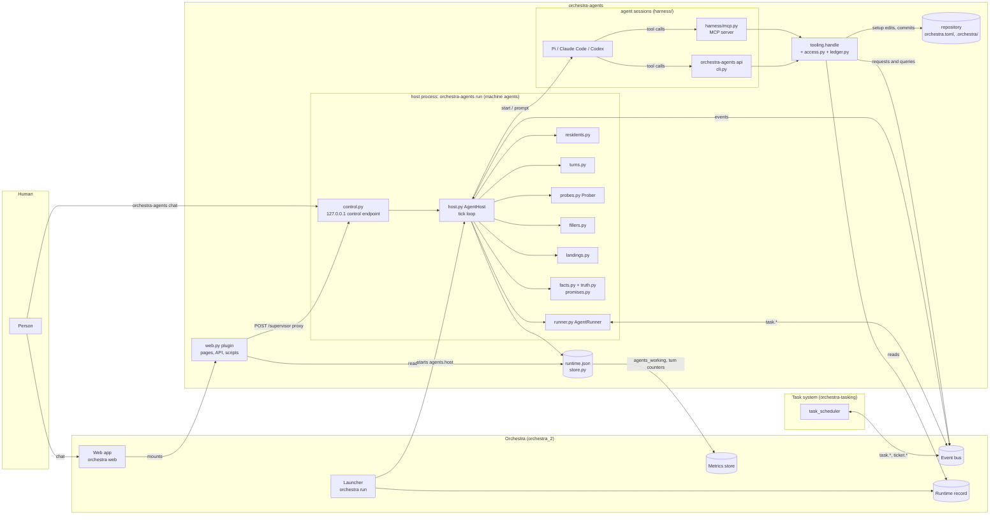
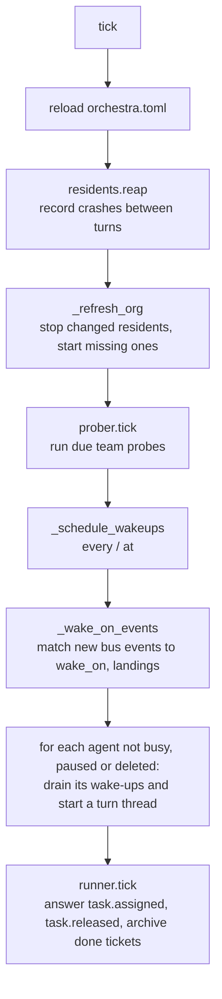
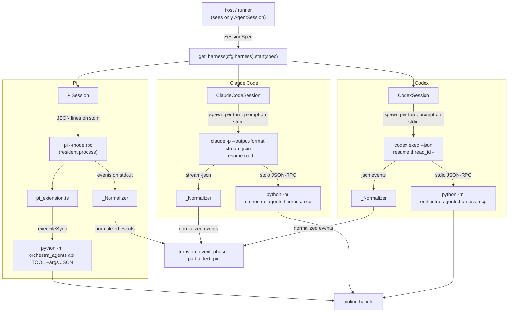
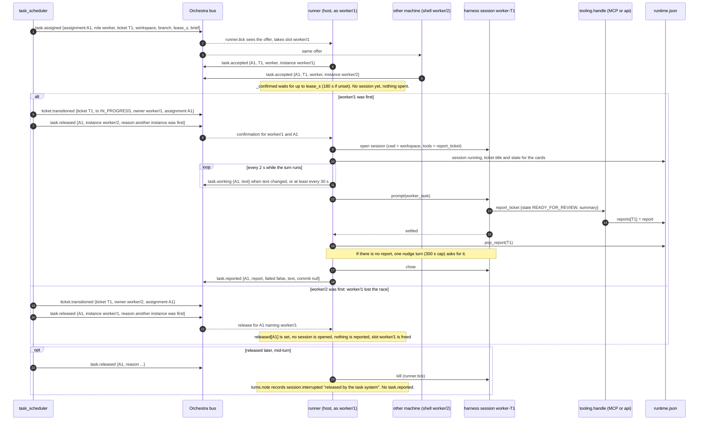
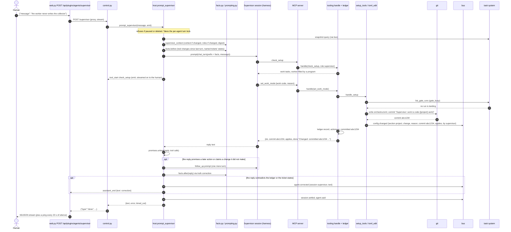

# orchestra-agents: architecture

This document explains how orchestra-agents works, for the owner and for engineers new to the
code. It describes the code on `main` at `91ce6dd`, with the role checks of `access.py` added since. Every module is named by its path under
`orchestra_agents/`. `SPEC.md` is the design and `AGENTS.md` holds the rules. This document
explains the code and does not replace either of them.

Contents:

1. [What it is](#1-what-it-is)
2. [The parts](#2-the-parts)
3. [How it plugs into Orchestra](#3-how-it-plugs-into-orchestra)
4. [The host and its control endpoint](#4-the-host-and-its-control-endpoint)
5. [The organisation: roles, agents, teams](#5-the-organisation-roles-agents-teams)
6. [Harnesses and sessions](#6-harnesses-and-sessions)
7. [Resident agents and wake-ups](#7-resident-agents-and-wake-ups)
8. [Filling the task system's roles: the runner](#8-filling-the-task-systems-roles-the-runner)
9. [The tools agents get](#9-the-tools-agents-get)
10. [The Supervisor as the human's operator](#10-the-supervisor-as-the-humans-operator)
11. [The Supervisor's facts and checks](#11-the-supervisors-facts-and-checks)
12. [How a human talks to it](#12-how-a-human-talks-to-it)
13. [Web panels and machine cards](#13-web-panels-and-machine-cards)
14. [Metrics](#14-metrics)
15. [Events: the full contract](#15-events-the-full-contract)
16. [Settings and state](#16-settings-and-state)
17. [Extending it: a custom role, a harness](#17-extending-it-a-custom-role-a-harness)
18. [Limits worth knowing](#18-limits-worth-knowing)

---

## 1. What it is

orchestra-agents runs AI agents as Orchestra machines. It is an Orchestra plugin, and it also
has a long-running process of its own, the **host**.

- The host keeps the **resident agents** up: the Supervisor (the human's one point of
  contact), the Coordinator (keeps the plan executable), and any custom agent.
- It wakes agents on the bus events they listen for, on their schedules, and on notes from
  other agents.
- When a task system (orchestra-tasking) offers a ticket to the `worker` or `reviewer` role,
  the host can fill that role. It starts one agent session for that ticket.
- The **harness** setting picks which product runs a session: Pi, Claude Code or Codex. Only
  the code under `harness/` knows which one is in use.
- The plugin adds the Agents page, the Supervisor chat, an attention banner and the agents'
  machine cards to Orchestra's web UI.

The guarantees we care about, and where each one comes from:

| What we care about | How the code delivers it |
|---|---|
| Agents are machines Orchestra can see | Every event goes on Orchestra's bus as a CloudEvent, with the agent's instance (`supervisor`, `worker/1`) as `source` (`events.py`). Each instance announces itself with `orchestra.machine.started` (`host.py` `_announce`). |
| The agents never change a ticket directly | Ticket and milestone tools are requests on the bus, and the task system applies them (`protocol.py` `TaskClient`). Nothing imports `tasking`. |
| No branching or worktree management | The task system names the workspace in the offer. The runner only runs a session in it (`runner.py`). |
| A lost race costs nothing | The runner starts a session only after the task system confirms that this instance owns this assignment (`runner.py` `_confirmed`). |
| No orphan processes | Each turn's pid is recorded on its session. A new host kills orphans on start (`host.py` `recover`). Shutdown closes turns, waits for their reports, then closes the residents, all inside the stop grace (`host.py` `run`, `closing.py`, `web.py` `STOP_GRACE_S`). |
| Bounded context | Each session's context is measured in tokens from the harness's own transcript. Past the limit the session is compacted or rotated (`residents.py` `trim_if_large`). |
| The human talks only to the Supervisor | The UI and CLI only read. The one write is the chat (`web.py` `POST /supervisor`, `control.py`). |
| The Supervisor fixes the setup, not the code | Its setup tools edit `orchestra.toml` one entry at a time. Each edit is committed with a reason and announced on the bus (`setup_tools.py`, `toml_edit.py`). There is no code-writing tool. |
| The Supervisor's replies are true | The tool calls are recorded in a ledger, the facts go in front of each turn, and Orchestra appends a correction when a reply contradicts them (`ledger.py`, `facts.py`, `truth.py`, `promises.py`). |
| One transcript | The harness's own session file is the only transcript. The host keeps markers beside it and never writes a parallel log (`store.py` `add_marker`, `web.py` transcript view). |

---

## 2. The parts



The modules, grouped by job:

| Job | Modules |
|---|---|
| Entry points | `cli.py` (the `orchestra-agents` command), `__main__.py`, `web.py` (`plugin`, the entry point `orchestra.plugins: agents`) |
| The host | `host.py`, `residents.py`, `turns.py`, `runner.py`, `control.py`, `closing.py`, `clock.py`, `probes.py`, `fillers.py`, `landings.py` |
| Harnesses | `harness/base.py`, `harness/pi.py`, `harness/pi_extension.ts`, `harness/claude_code.py`, `harness/codex.py`, `harness/mcp.py`, `harness/tools.py`, `harness/__init__.py` |
| Tools | `tooling.py`, `access.py`, `api_org.py`, `ledger.py`, `observe.py`, `observe_model.py`, `setup_tools.py`, `toml_edit.py`, `toml_entries.py`, `restart.py`, `gate_busy.py`, `secret_shapes.py` |
| The Supervisor's honesty checks | `promises.py`, `facts.py`, `truth.py`, `ledger.py` |
| Organisation | `builtins.py`, `roles.py`, `org.py`, `org_store.py`, `org_views.py`, `prompting.py`, `prompts/` |
| Contract with the task system | `protocol.py` |
| Bus, state, settings, metrics | `events.py`, `store.py`, `config.py`, `measures.py` |
| UI | `static/agents.html`, `static/agents.js`, `static/agents.css`, `static/attention.js`, `static/machine-cards.js` |

---

## 3. How it plugs into Orchestra

The package registers an Orchestra plugin in `pyproject.toml`:

```toml
[project.entry-points."orchestra.plugins"]
agents = "orchestra_agents.web:plugin"
```

`web.plugin(orchestra_project)` returns an `orchestra.plugins.Plugin` with these parts:

| Part | Value | Source |
|---|---|---|
| Name | `agents` (API at `/api/plugins/agents`, static files at `/plugins/agents/static/`) | `web.plugin` |
| Pages | `/agents`, titled "Agents" (`static/agents.html`) | `web.plugin` |
| Scripts on every page | `attention.js`, `machine-cards.js` | `web.plugin` |
| Stylesheets on every page | `agents.css` | `web.plugin` |
| API router | see [section 13](#13-web-panels-and-machine-cards) | `web.router` |
| Declared machines | `agents` (program, continuous), plus every agent from `org_store.all_agents` (kind `agent`, `continuous` if resident or `ad hoc`, and what it wakes on) | `web.declared` |
| Processes | `host`: `[sys.executable, -m, orchestra_agents, run, --wait]` with `stop_grace_s=30`, **only when `orchestra.toml` has an `[agents]` section** | `web.processes` |

So `orchestra run` starts the host as the process `agents.host`, keeps it running and stops it.
A project without `[agents]` still gets the pages, but no host runs and no AI is started.

Declared machines only fill gaps on Orchestra's Machines page. What Orchestra shows comes from
what it observes on the bus (Orchestra rule 2).

The host uses Orchestra only as a library:

- the bus, through `orchestra.events.Events` (wrapped by `events.py`);
- the metrics store, through `orchestra.metrics.for_project` (`measures.py`, `observe_model.py`);
- the runtime record, through `orchestra.runtime` (`restart.py`, `observe.py`, `setup_tools.py`);
- the readers of `orchestra.toml`: `orchestra.config`, `orchestra.launcher`,
  `orchestra.collect.spec` (`toml_edit.py`);
- the model view and log readers: `orchestra.web.dynamics.model_view` and
  `orchestra.web.machine_logs`.

---

## 4. The host and its control endpoint

`orchestra-agents run` creates `host.AgentHost` and calls `run(wait=...)`. There is one host per
project. On the bus it is the machine `agents`.

### Start-up

1. **Take the project** (`_take_project`). If another live host's pid is in
   `runtime.json` `control`, or the control port cannot be bound, the host stops here. Without
   `--wait` it exits with status 1. With `--wait`, which is how the launcher starts it, it
   checks again every 2 s (`WAIT_RETRY_S`).
2. **Serve the control endpoint** (`_start_control`). This is a `ControlServer` on 127.0.0.1 at
   `[agents] control_port` (0 means any free port). The port and pid are recorded with
   `store.set_control`.
3. **Recover** (`recover`). For each session left `running` with a pid, the host kills that
   process group (`_kill_orphan`). It marks the turn `session.interrupted` and sets the session
   to idle.
4. **Finish an interrupted restart.** `restart.recover` puts back a `[[machines]]` entry that an
   interrupted `restart_machine` took out ([section 10](#10-the-supervisor-as-the-humans-operator)).
5. **Announce** `orchestra.machine.started` from `agents` with
   `{package: agents, mode: continuous, kind: program, listens_for: [ticket.transitioned], log}`.
6. **Load the organisation** (`_refresh_org`) and start the resident sessions
   (`Residents.start_missing`).
7. **Write idle metric points** for every measured role (`store.measure_idle`).

### The tick (once a second)



- The config is re-read every tick. A change to `[agents]` takes effect within a second.
- Each agent gets at most one turn thread (`agent_threads`). One lock per agent
  (`_turn_lock`) keeps a wake-up and a chat turn from running on the same session at once.
- Per-ticket workers and reviewers are never woken. They only answer assignments.
- The Supervisor is not woken while it has no resident session.

### Shutdown

When the host gets SIGTERM or SIGINT:

1. Each running turn is marked `session.interrupted` with the reason "orchestra shut down".
2. Every per-ticket session that is mid-turn is closed together (`closing.close_together`, each
   close at most `CLOSE_S` = 5 s).
3. The host waits up to `SHUTDOWN_REPORTS_S` (10 s) for each open assignment's `task.reported`
   (`failed`) to go out. The contract has no release that a machine can send.
4. The resident sessions are closed together (5 s).
5. The control endpoint stops, and the control record is cleared only if it is still this pid's.

The worst case is 20 s (`SHUTDOWN_WORST_S`), which is under the 30 s stop grace the plugin
declares (`web.STOP_GRACE_S`).

### The control endpoint (`control.py`)

The endpoint is a `ThreadingHTTPServer` bound to 127.0.0.1 only.

| Method and path | Body | Answer |
|---|---|---|
| `GET /health` | none | `{"ok": true}` |
| `POST /supervisor` | `{"message": "..."}` | An NDJSON stream of events, then `{"type": "done", ...}`. See [section 12](#12-how-a-human-talks-to-it). |

Each POST runs `AgentHost.prompt_supervisor` on the request thread.

---

## 5. The organisation: roles, agents, teams

The organisation has three kinds of record, kept apart (`roles.py`, `org.py`):

| Thing | What it is | Where it lives |
|---|---|---|
| **Role** | A job description: a prompt and the tool groups the job needs. It has no schedule and no session. | Built-in: `builtins.py` and `prompts/<role>.md` (`<role>.tasks.md` when `[project] work = "tasks"`). Custom: `.orchestra/roles/<name>.json` and `<name>.md`. |
| **Agent** | An instance of one or more roles, optionally in a team. This is what runs. It has a `kind` (`continuous`, `scheduled`, `ad_hoc`), a `session` (`resident`, `ephemeral`), `wake_on`, `every` and `at`. | Built-in: `org.built_in_agents`. Custom: `.orchestra/agents/<name>.json`. |
| **Team** | One lead, members, responsibilities, access grants, declared `emits`, `probes`, and a space at `.orchestra/spaces/<team>/` whose `tools/` is on its agents' PATH. | Built-in: `engineering` (`org.BUILTIN_TEAMS`). Custom: `.orchestra/teams/<name>.json` and `.md`. |

### The built-ins

| Agent | Kind | Tool groups | Woken by | Team |
|---|---|---|---|---|
| `supervisor` | continuous, resident | tickets, context, pipeline, roles, team, events, observe, setup | `task.attention_needed:supervisor`, `orchestra.process.gave_up`, a human message, `escalate_to_supervisor`, a crash loop, a landing of a human's ticket | none |
| `coordinator` | continuous, resident; `scheduled` when `[agents] coordinator_every` is set | tickets, capacity, escalate (+ `team`, because it is in a team) | `task.attention_needed:coordinator`, the optional schedule | `engineering` (lead) |
| `worker` | ad hoc, one session per ticket | report_ticket | `task.assigned` for `worker` (through the runner) | `engineering` |
| `reviewer` | ad hoc, one session per ticket | report_review | `task.assigned` for `reviewer` (through the runner) | `engineering` |

`worker` and `reviewer` are agents only for the roles in `[agents] serves`
(`org_store.all_agents`). A role that another machine fills, such as the demo's shell worker, is
not an agent here.

### Rules the code enforces (`org.py`)

- Names are `^[a-z][a-z0-9_]{1,40}$`. Team names nest with `/`, as in `product/qa`.
- `continuous` requires `resident`. `ad_hoc` requires `ephemeral` and has no `every` or `at`.
  `scheduled` needs `every` or `at`.
- `wake_on` entries must be known event types (`org.EVENT_TYPES`) or types a team declares in
  `emits`. A filter after the colon (`type:x`) matches the event's `to`, `status`, `probe` or
  `subject` (`org.event_matches`).
- A team's `emits` must be new lowercase names, never Orchestra's or the task system's types.
- **Tool groups are granted by roles and teams** (`org.effective_tools`). Every agent in a team,
  and every team lead, also gets `team`. A per-ticket worker or reviewer gets only its exit tool.
  The `setup` group is not in `roles.TOOL_GROUPS`, so no custom role or team can be given it.
  `roles` is, but every change it names (`api_org.MUTATIONS`, which includes pausing, resuming,
  restarting and resetting an agent) is the Supervisor's alone, so a custom holder of `roles`
  can read `org_guide` and nothing more.
- **Groups are enforced on every call**, not only by what a harness lists (`access.authorize`,
  [section 9](#9-the-tools-agents-get)).
- **Path grants are not enforced.** They are written into the prompt under "Where you work".
  The harnesses run with their own permission checks off.
- Messages follow the tree (`org.may_message`). The Supervisor may message anyone. A lead may
  message its members and the leads of its sub-teams. An agent may message its own lead.

### Prompts (`prompting.py`)

- A built-in agent outside a custom team gets exactly its role prompt (`role_prompt`). That is
  the project's override from `[agents] prompts`, else `prompts/<role>.<work>.md`, else
  `prompts/<role>.md`.
- Other agents get `AGENT_PREAMBLE`, then each role's prompt, then each team's
  responsibilities up the chain, then "Where you work" (`agent_prompt`).
- `role_prompt` fills these placeholders: `{operator}` (`prompts/operator.md`),
  `{base_branch}`, `{ticket_prefix}` and `{machines_doc}`.
- The prompt a session started with is saved as `logs/agents/<session>.prompt.md`
  (`host._open_session`).

### Changes

All changes to the organisation go through the Supervisor's `roles` tools (`api_org.py`).

- Writes go under `.orchestra/`. They are committed to the base branch only when the checkout is
  on it and has no other changes (`roles.commit_orchestra_files`). Otherwise the files are left
  uncommitted, and the tool's `storage` field says so.
- Changing a team, or updating a role, sets `restart_requested` on the affected resident agents.
  `Residents.stop_changed` closes each one after its current turn, and the next tick starts it
  again with the new prompt.

### Probes (`probes.py`)

A team's `probes` entries look like `{name, command, every, timeout?}`.

- `Prober` runs each probe in the team's space, with the team chain's `tools/` on PATH, in a
  thread of its own.
- Exit 0 means the condition holds.
- The prober emits `probe.failed` (`{probe, team, output}`) or `probe.recovered`
  (`{probe, team}`) only when the state changes.

The task system's own `[[probes]]` are separate.

---

## 6. Harnesses and sessions

A **harness** is the product that runs an agent. A **session** is one named, resumable
conversation on it. The host sees only the `harness/base.py` interface:

| Member | Meaning |
|---|---|
| `Harness.start(spec: SessionSpec) -> AgentSession` | Create a session object. It starts a process only for Pi. |
| `Harness.read_transcript(file)` | Parse the product's transcript into `[{role: user\|assistant\|toolResult, text, tool_calls, ts}]` |
| `Harness.context(file) -> ContextSize` | The tokens of the last model call, and the compactions the transcript records |
| `AgentSession.open()` | Make the session exist and learn `session_file`. Safe to call more than once. |
| `AgentSession.prompt(text, timeout, on_event, idle_timeout) -> TurnResult` | Run one turn. It ends when the agent settles, after `idle_timeout` with no event (`stopped_by="silence"`), or at the `timeout` cap (`"limit"`). |
| `compact()` | Ask the product to summarise older context. Returns `None` if it cannot. |
| `pid`, `alive()`, `kill()`, `close()` | Process state. `kill()` ends the running turn. `close()` releases the session and keeps the transcript. |
| `retire()` | Forget the session so the next `open` starts fresh. Returns where the old transcript is. |

`SessionSpec` carries `session_id`, `session_dir`, `cwd`, `system_prompt`, `role`, `tool_groups`,
`env`, `log_path`, `model`, `provider`, `thinking` and `compact_tokens`. The host always sets
these variables in `env` (`host._open_session`):

| Variable | Value |
|---|---|
| `ORCHESTRA_ROLE` | The agent's name or the role: `supervisor`, `worker`, a custom agent's name. A call whose `ORCHESTRA_ROLE` differs from its token's role is refused. |
| `ORCHESTRA_SESSION_TOKEN` | A token issued for this session (`access.issue`). `runtime.json` `grants` keeps its SHA-256 with the role and ticket. The role and ticket a tool call runs as are the token's. |
| `ORCHESTRA_SOURCE` | The machine instance: `supervisor`, `worker/1` |
| `ORCHESTRA_REPO` | The repository root |
| `ORCHESTRA_TICKET` | The ticket id for a per-ticket session, otherwise `""` |
| `ORCHESTRA_TEAM`, `PATH` | For an agent in a custom team: the team name, and the team chain's `tools/` |

Each harness also adds `ORCHESTRA_TOOLS`, the comma-separated tool groups.

### Normalized events

Each harness turns its product's stream into one vocabulary:

`turn_start {pid}` · `assistant_start` · `token {kind, delta}` · `tool_start {name, args}` ·
`tool_end {name}` · `assistant_end {text, tool_calls}` · `settled {text}`

`turns.Turns.on_event` turns these into the session's `phase` (`prompting`, `generating`,
`tool`, `idle`), `partial_text`, `last_text` and `tool_name` in `runtime.json`. The cards and the
heartbeats read those fields. The pid in `turn_start` is recorded so that a later host can kill
an orphan.

### The three harnesses

| | Pi (`harness/pi.py`) | Claude Code (`harness/claude_code.py`) | Codex (`harness/codex.py`) |
|---|---|---|---|
| Process | One `pi --mode rpc` per session, kept running between turns | `claude -p` for each turn | `codex exec --json` for each turn |
| Resume | `--session-dir`/`--session-id` | `--session-id <uuid>` first, then `--resume <uuid>`; the uuid is in `sessions/claude-code/<id>.json` | `resume <thread_id>` from the first `thread.started`; kept in `sessions/codex/<id>.json` |
| System prompt | `--append-system-prompt` | `--append-system-prompt-file` | `-c developer_instructions=...` |
| Tools | `pi_extension.ts`, which reads `orchestra-agents tools --json` and calls `orchestra-agents api <tool>` | MCP server `harness/mcp.py`, set up with `--mcp-config` and `--strict-mcp-config` | The same MCP server, through `-c mcp_servers.orchestra={...}` |
| Permissions | — | `--dangerously-skip-permissions` | `--sandbox danger-full-access` |
| Transcript | Pi's JSONL in `session_dir` | `$CLAUDE_CONFIG_DIR/projects/<cwd-key>/<uuid>.jsonl` | `$CODEX_HOME/sessions/YYYY/MM/DD/rollout-*-<thread>.jsonl` |
| Compaction | When asked (`{"type":"compact"}`) | Compacts itself (`--autocompact`); `compact()` answers `{"mode": "auto"}` | Cannot compact, so the session is rotated |
| `alive()` | The process is running | Not closed | Not closed |
| Binary | `PI_BINARY` | `CLAUDE_BINARY` | `CODEX_BINARY` |



### Keeping context bounded (`residents.trim_if_large`)

Before a resident's turn, the host calls `residents.trim_if_large`. Before a per-ticket turn, the
runner calls it.

1. It reads `Harness.context(session_file)`, which gives the tokens of the last model call. The
   transcript's file size is never used.
2. It publishes `agent.compacted` once for each compaction recorded since the last check
   (tracked in `compactions_seen`).
3. If the tokens exceed `compact_tokens` (default 100,000), the action depends on the harness:
   - Claude Code compacts itself, so nothing is done.
   - Pi is asked to compact.
   - Codex is **rotated**: the old transcript is retired and archived as a run, and
     `agent.reset` is published with `by=orchestra`.

### Turns that end badly (`turns.Turns.note`)

| How the turn ended | Event |
|---|---|
| Hit the silence limit or the hard cap | `session.timed_out {session, agent, ticket, stopped_by, limit, doing, phase_for, silent_for, last_text}` |
| The harness failed | `session.error {session, agent, ticket, error}` |
| Released by the task system, or the host shut down | `session.interrupted {session, agent, ticket, reason}` |

Each of these is also stored on the session as a **marker** (`store.add_marker`, the last 50).
The transcript view overlays the markers on the harness's transcript.

---

## 7. Resident agents and wake-ups

A resident agent has a session that stays open, with the session id `<name>` (underscores become
dashes). An ephemeral agent gets a new session for each run: `<name>-<YYYYmmdd-HHMMSS>`.

**What queues a wake-up** (`store.add_wakeup`, a queue in `runtime.json`):

| Source | Code |
|---|---|
| A bus event that matches the agent's `wake_on` | `host._wake_on_events` |
| `every` has passed, or the daily `at` time has come | `host._schedule_wakeups` |
| `escalate_to_supervisor` | `tooling._handle` |
| `message_agent`, `run_agent` | `api_org._handle` |
| Agent created or changed; team created or changed (wakes the lead); role updated | `api_org._handle` |
| A crash loop (wakes the Supervisor) | `residents.reap` |
| A ticket the Supervisor created for the human reaches DONE | `landings.Landings.see` |

**A wake-up turn** (`host._wake_turn`):

1. Ask the task system for a `snapshot`, waiting up to 30 s. If the task system does not answer
   and every reason is a schedule, skip the turn.
2. Trim the context if needed, and reopen the resident session if it has died.
3. Build the prompt with `prompting.wake_task`: the reasons, execution health, who fills the
   roles (`fillers.Fillers.lines`), and the snapshot.
4. For the Supervisor, put `SUPERVISOR_WAKE`, the context or digest, and the facts in front, and
   run the reply through the checks in [section 11](#11-the-supervisors-facts-and-checks).
5. Mark the session idle, publish `agent.said {session, summary}`, and close the session if it
   is ephemeral.

**Crashes** (`residents.reap`): a resident process that exits between turns is recorded as
`agent.crashed {session, agent, count, stderr}`. The next tick restarts it. Three crashes in 15
minutes pause the agent, publish `agent.crash_loop`, and wake the Supervisor. Only Pi keeps a
process between turns. For Claude Code and Codex, `alive()` is true until `close()`, so a crash
between turns cannot happen there.

**Pause, resume, restart, reset** are flags in the agent's state (`api_org.py`):

| Flag | Effect |
|---|---|
| `paused` | Wake-ups stay queued until resumed |
| `restart_requested` | `Residents.stop_changed` closes the session after the current turn, and `start_missing` opens it again |
| `reset_requested` | Like a restart, but the old transcript is archived under `<id>-reset-<time>` and `agent.reset` is published |

---

## 8. Filling the task system's roles: the runner

`runner.AgentRunner` runs inside the host, and `runner.tick` runs on every host tick. It answers
`task.assigned` for each role in both `builtins.PER_TICKET_ROLES` (`worker`, `reviewer`) and
`[agents] serves`. The event names are in `protocol.py`. The task system's field tables are in
orchestra-tasking's `tasking/assignments.py`.

### The protocol as this side implements it

| Step | Event (source → bus) | Data this side sends or reads |
|---|---|---|
| Offer | `task.assigned` (task_scheduler) | Read: `assignment`, `role`, `ticket`, `workspace`, `branch` (null in tasks mode), `lease_s`, `brief` (ticket fields, `worker_turns`), `unit_command` (code worker), `review {summary, commit, test_output}` (reviewer) |
| Accept | `task.accepted` (instance, e.g. `worker/1`; subject = ticket) | `{assignment, ticket, role, instance}` |
| Confirmation | `ticket.transitioned` (task_scheduler) | Read: `ticket`, `owner` = this instance, and `assignment` = this assignment. If an older task system leaves out `assignment`, ticket and owner alone are enough. |
| Lost or taken back | `task.released` (task_scheduler) | Read: `assignment`, `reason`, and `instance` (null, or this instance) |
| Heartbeat | `task.working` (instance) | `{assignment, ticket, role, text}`: at least every `HEARTBEAT_S` (30 s), and sooner (checked every 2 s) when the agent's latest text changes. `text` is the last 160 characters of `partial_text` or `last_text`. |
| Report | `task.reported` (instance) | `{assignment, ticket, role, report, failed, text, commit}`. `text` is the agent's last 2,000 characters. `commit` is the offer's `review.commit` for a code review, otherwise null. |

The **report** values:

| Case | `report` | `failed` |
|---|---|---|
| A worker called `report_ticket` | `{state: READY_FOR_REVIEW \| BLOCKED, summary, blocked_reason}` | `false` |
| A reviewer called `report_review` | `{verdict: APPROVED \| REJECTED, summary, feedback}` | `false` |
| The turn and one nudge ended normally with no report | `null` | `false` (the task system blocks the ticket for a planner) |
| The turn timed out or the harness failed | the report if one was made, else `null` | `true` |
| No confirmation within the lease, or an exception | `null` | `true` |
| The host stopped mid-turn | `null` | `true` |
| Released (lost race, or taken back) | **nothing is sent** | — |

### An assignment run, with a lost race

The host takes the lowest free slot of the role (`worker/1`, `worker/2`, ...) on the main thread
(`host._instance`). Each assignment then runs in a thread of its own (`runner._run`).



### Details that matter

- **Prompts.** A worker gets `prompting.worker_task` (code: a worktree on `branch`, with the
  unit command) or `worker_task_tasks` (tasks: write `RESULT.md` in the scratch folder). A
  reviewer gets `reviewer_task`. For it, the runner reads
  `git diff <base>...<commit>`, the changed file names and `git log` in the workspace, plus the
  task system's test output. In tasks mode it gets `reviewer_task_tasks` with the folder's files
  and `RESULT.md`. Rejection feedback and `rejected_by` from the brief go into the worker's
  prompt.
- **The nudge** (`turns.prompt_with_retry`). If the first turn ends with no report and no
  error, one more prompt asks for the exit tool, with a 300 s cap. If the assignment was released
  in between, the nudge is not sent.
- **Archive.** A `ticket.transitioned` to `DONE` or `CANCELLED` moves `worker-<T>` and
  `reviewer-<T>` to `archived_sessions` (`store.purge_ticket_sessions`).
- **Host crash.** The host reports nothing it did not see end. The task system re-offers the
  ticket when its lease runs out.
- **Who fills the roles** (`fillers.py`). `Fillers` watches `task.accepted` and
  `orchestra.machine.started`, including the last 5,000 events at start. It tells the planners
  which instances fill each role and what `kind` each announced, for up to 6 h after last
  seen. `check_setup` uses it too.

---

## 9. The tools agents get

### One catalogue, three ways in

- **The catalogue** is `harness/tools.py` `TOOLS`. Each entry is a `ToolDef`
  `(name, group, description, properties, required)`. The input schema sets
  `additionalProperties: false`.
- **MCP** (`harness/mcp.py`) is used by Claude Code and Codex. It is stdio JSON-RPC 2.0 with the
  methods `initialize`, `tools/list` and `tools/call`. It lists only the tools of the groups in
  `ORCHESTRA_TOOLS` and refuses any other tool name. A call runs `tooling.check_args`, then
  `access.identify` (the role and ticket of the session's token), then
  `tooling.handle(project, store, name, args, role=<token's role>, ticket_env=<token's ticket>)`.
  The result is JSON text, and an error is `{"ok": false, "error": ...}` with `isError: true`.
- **Pi** (`harness/pi_extension.ts`) registers the output of `orchestra-agents tools --json`
  (filtered by `ORCHESTRA_TOOLS`). Each call runs
  `python -m orchestra_agents api <tool> --args <json>` (`cli.cmd_api`). That command refuses to
  run without `ORCHESTRA_SESSION_TOKEN`, runs `access.identify`, `check_args`, then `handle`, and
  prints JSON.
- **`tooling.handle`** first runs `access.authorize`, then wraps `_handle` with `ledger.record`. A successful call that changed
  something gains a `done` field (`"Changed: <line>."`), and the line is kept in the agent's
  `actions` (the newest 40).

`check_args` refuses an argument the schema does not name, and a required argument that is
missing or empty.

**Who is calling.** `host._open_session` issues each session a token (`access.issue`) and puts
it in the session's environment as `ORCHESTRA_SESSION_TOKEN`. `runtime.json` `grants[session id]`
keeps its SHA-256, the role and the ticket. Opening a session of the same id replaces the grant.
The runner, an ephemeral wake-up and `Residents.stop_changed`/`close_all` revoke it when they
close the session, and `host.recover` drops every grant when a host starts. `access.identify`
looks the token up and returns the grant's role and ticket. It refuses a missing token, a token
with no grant, and an `ORCHESTRA_ROLE` that names another role. So a shell inside a worker's
session that runs `ORCHESTRA_ROLE=supervisor orchestra-agents api pause_agent ...` is refused.
`ORCHESTRA_TICKET` is no longer read for a call; a worker cannot report on another ticket.

**Who may call what.** `access.authorize`, at the top of `handle`, refuses:

- an empty role, and a role that names no agent and no built-in role;
- any tool whose group the role does not hold now (`org.effective_tools` over the current
  roles and teams; a built-in name always means the built-in agent). The error names the role,
  the group the tool needs and the groups the role has.

Then `handle` checks the role again for these commands:

| Command(s) | Allowed role |
|---|---|
| `report_ticket` | `worker` |
| `report_review` | `reviewer` |
| `update_project_context` | `supervisor` |
| Organisation mutations (`create_`/`update_`/`delete_` role, agent, team) and `pause_agent`, `resume_agent`, `restart_agent`, `reset_agent` (`api_org.MUTATIONS`) | `supervisor`, even for a custom role or team granted `roles` |
| All `setup` tools and `restart_machine` | `supervisor` |
| Ticket and milestone **requests** | `supervisor`, `coordinator`, and custom agents whose effective groups include `tickets` (`may_change_tickets`) |
| `message_agent`, `run_agent` | Any role, along the tree (`org.may_message`) |
| `emit_event` | Types declared by the caller's team chain (the Supervisor may raise any non-reserved type). At most 3 deep in a cause chain and 20 per hour. |

Everything else (queries, reads, `escalate_to_supervisor`) needs only its group. The pages and
the CLI do not call `handle`: they read the organisation through `api_org.read_org`, which
serves only `list_`/`get_` roles, agents and teams. See [section 18](#18-limits-worth-knowing) for
what the token does not stop.

### The tools

Arguments marked `*` are required. "Request" means a CloudEvent to the task system,
`TaskClient` waits up to 30 s for `request.done` or `request.refused`, and the tool returns the
task system's `result`. A refusal or no answer raises an error. "Query" works the same way, with
`task.query_requested {op}`.

| Tool | Group | Arguments | Returns / changes |
|---|---|---|---|
| `report_ticket` | report_ticket | state* (`READY_FOR_REVIEW`\|`BLOCKED`), summary*, blocked_reason (required if BLOCKED) | Stores the report in `runtime.json` `reports[ticket]`. The runner sends it. |
| `report_review` | report_review | verdict* (`APPROVED`\|`REJECTED`), summary*, feedback (required if REJECTED) | Same as above |
| `project_status` | tickets | — | Query |
| `list_milestones` | tickets | — | Query |
| `create_milestone` | tickets | name*, description | Request `milestone.requested` |
| `update_milestone` | tickets | id*, name, description, order | Request `milestone.change_requested` |
| `close_milestone` | tickets | id* | Request `milestone.close_requested` |
| `list_tickets` | tickets | state, milestone_id | Query |
| `get_ticket` | tickets | id* | Query |
| `create_ticket` | tickets | title*, objective*, description*, acceptance*, verification*, milestone_id*, priority, depends_on | Request `task.requested` |
| `update_ticket` | tickets | id*, title, description, acceptance, verification, objective, priority, milestone_id, depends_on | Request `task.change_requested` |
| `add_note` | tickets | id*, text* | Request `task.note_requested` |
| `cancel_ticket` | tickets | id*, reason* | Request `task.cancel_requested` |
| `unblock_ticket` | tickets | id*, note* | Request `task.unblock_requested` |
| `get_project_context` | context | — | `{context}` from `PROJECT.md`, seeded from `.orchestra/PROJECT.md` or a template |
| `update_project_context` | context | text* (at least 20 characters) | Rewrites `PROJECT.md` and publishes `context.updated {by}` |
| `get_gate_run` | pipeline | id* | Query |
| `list_gate_runs` | pipeline | — | Query |
| `get_staging_status` | pipeline | — | Query |
| `resume_pipeline` | pipeline | note* | Request `pipeline.resume_requested` |
| `get_capacity` | capacity | — | Query |
| `set_capacity` | capacity | workers, reviewers, note* | Request `capacity.change_requested` (the runtime dial) |
| `emit_event` | events | type*, subject, note | Publishes `<type> {by, subject, note, depth, team}`. Returns `{event, wakes}`. |
| `read_events` | events | minutes (default 60), types | `{events (the last 200), count}`. Leaves out `session.started` and `session.settled`. |
| `list_teams`, `get_team` | team | name* for `get_team` | Views from `org_views.py` |
| `list_agents`, `get_agent` | team | name* for `get_agent` | Views, including each agent's effective tools and full prompt |
| `list_roles`, `get_role` | team | name* for `get_role` | Views, including the prompt and its source |
| `run_agent` | team | name*, brief* | Queues a brief for an **ad hoc** agent. Publishes `agent.messaged`. |
| `message_agent` | team | name*, note* | Queues a note on a non-ad-hoc agent's next wake-up. Publishes `agent.messaged`. |
| `org_guide` | roles | — | `prompts/org_guide.md` plus a reference list of groups and event types |
| `create_role` / `update_role` / `delete_role` | roles | name*, description*, prompt* (≥40 characters on create), tools | Writes `.orchestra/roles/`, maybe commits. Publishes `role.created`/`changed`/`deleted`. |
| `create_agent` / `update_agent` / `delete_agent` | roles | name*, roles*, kind*, team, session, wake_on, every, at, description | Writes `.orchestra/agents/`. Publishes `agent.created`/`changed`/`deleted`. Wakes a new or changed non-ad-hoc agent. |
| `pause_agent` / `resume_agent` | roles | name* | Sets `paused` and clears the crash-loop state. Publishes `agent.paused`/`resumed`. |
| `restart_agent` | roles | name* | Sets `restart_requested`. No event. |
| `reset_agent` | roles | name* (resident only) | Sets `reset_requested`. `agent.reset` follows on the next tick. |
| `create_team` / `update_team` / `delete_team` | roles | name*, lead*, responsibilities* (≥20 characters on create), description, members, access, tracked, emits, probes | Writes `.orchestra/teams/`, creates the space and `.gitignore` entry. Publishes `team.*`. Restarts the members' resident sessions. |
| `check_setup` | observe | — | `{work, roles, not_launched, gate_tests, capacity_limit, launcher, processes, collectors, entries_left_out, config_can_change}` |
| `read_config` | observe | — | `{path, text (secrets shown as <hidden>), can_change, recent_commits}` |
| `list_processes` | observe | — | `{launcher, processes[{name, owner, state, pid, up_s, restarts, last_exit_code, command, log}], collectors, entries_left_out}` |
| `read_machine_log` | observe | name*, lines (default 80, at most 400) | `{name, log, lines}`. Reads only inside the repository or Orchestra's state directory. |
| `list_metrics` | observe | prefix | `{store, names, metrics[{name, series, labels, last_written_s_ago, points_last_hour}]}` |
| `get_model` | observe | — | `{version, live, as_of, stocks, flows (with equation and origin), machines, discovery, left_out}` |
| `snapshot` | observe | — | Query `snapshot` |
| `set_agent_roles` | setup | serves*, reason* | `[agents] serves` (see [section 10](#10-the-supervisor-as-the-humans-operator)) |
| `set_work_mode` | setup | work* (`tasks`\|`code`), reason* | `[project] work`. Restarts the residents whose prompt has a `.tasks.md` variant. |
| `set_gate_unit` | setup | command*, reason*, name (default `unit`), timeout | Upserts a `[[gate.unit]]` entry |
| `set_capacity_limit` | setup | reason*, workers, reviewers | `[tasks] workers`/`reviewers` |
| `set_machine` | setup | name*, command*, reason*, restart, stop_grace | Upserts a `[[machines]]` entry |
| `set_collector` | setup | name*, reason*, command **or** url, every, timeout | Upserts a `[[collect]]` or `[[scrape]]` entry |
| `remove_entry` | setup | section* (`machines`\|`collect`\|`scrape`\|`gate.unit`), name*, reason* | Removes the entry from the text |
| `restart_machine` | setup | name*, reason* | Takes the entry out and puts it back. No commit. Publishes `machine.restarted`. |
| `escalate_to_supervisor` | escalate | note* | Queues a Supervisor wake-up `[<role>] <note>` |

---

## 10. The Supervisor as the human's operator

The human talks only to the Supervisor (Orchestra rule 9). When the system cannot do what the
human asks, the Supervisor finds out why and changes the setup. It never changes code.

### The diagnosis duty (`prompts/operator.md`)

`supervisor.md` and `supervisor.tasks.md` include this text through `{operator}`. It tells the
Supervisor to look before concluding, and to follow these steps when a ticket blocks, is rejected
twice for the same reason, or a request of the human's is not met:

1. **Who fills the worker role?** A program, or an AI agent? (`check_setup`; fix with
   `set_agent_roles`, `set_machine`.)
2. **Must the result land in the repository?** If so, set `work = "code"` (`set_work_mode`).
3. **Can a branch land?** Check the gate's tests (`set_gate_unit`). Never guess a test.
4. **Is what is needed running?** Use `list_processes` and `read_machine_log`. Fix a cause in
   the entry with `set_machine` or `set_collector`. A cause in the code is a bug ticket. Then
   `restart_machine`.
5. **Is anything offered at all?** Check the capacity (`set_capacity_limit`).

Then it tells the human what changed, why, and the commit id. It must never keep filing tickets
the system cannot complete.

The Supervisor is also woken by `orchestra.process.gave_up`. `host._wake_reason` names the
process, its failures, its last exit code and its log path.

### Read tools (`observe.py`, `observe_model.py`)

The `observe` group only reads, through Orchestra as a library. See the table in
[section 9](#9-the-tools-agents-get). Two details:

- `read_config` passes the text through `secret_shapes.redact`.
- `check_setup.not_launched` names programs seen filling a role that Orchestra's launcher does
  not run. The Supervisor cannot restart or change those.

### Config tools (`setup_tools.py`, `toml_edit.py`, `toml_entries.py`)

`setup_tools.handle_setup` runs these steps for every setup tool:

1. Refuse unless the caller's role is `supervisor`.
2. `restart.recover`: put back an entry that an interrupted restart left out.
3. Build the `Plan` (validate the arguments).
4. `gate_busy.landing`: if a `task_scheduler` was seen on the bus, ask `list_gate_runs` (10 s).
   Refuse while a run is `running`, because a commit to the base branch would make the landing
   fail.
5. `toml_edit.change`:
   - The reason must be at least 10 characters.
   - The root must be a git checkout on `base_branch`, with no uncommitted change to
     `orchestra.toml` (`why_not_committable`).
   - Apply the edit on a `tomlkit` document, which keeps comments and layout.
     `toml_entries.remove` cuts a removed entry out of the text.
   - Refuse any new line that looks like a secret (`secret_shapes.secret_in`).
   - Refuse a result that does not parse, or that Orchestra's readers (`orchestra.config`,
     `orchestra.launcher`, `orchestra.collect.spec`) or `config.Config` accept less well than
     before (`check`).
   - Write the file atomically, then run
     `git commit -m "Supervisor: <what>\n\n<reason>" -- orchestra.toml`. If the commit fails,
     the old text is put back.
6. If nothing changed, answer `{commit: null, applies: "Nothing changed..."}` and publish
   nothing.
7. Otherwise publish `config.changed {section, change, reason, commit, applies, by}` from the
   Supervisor's instance.
8. Answer `{ok, changed, commit, applies, next}`. Then run `plan.then`, for example the
   restart flags after `set_work_mode`.

`applies` describes when the change takes effect, according to each reader's rules:

| Section | Reader | When it applies |
|---|---|---|
| `[agents]` | the agents' host | Every second |
| `[project]`, `[tasks]`, `[gate]` | the task system's scheduler | Every tick |
| `[[machines]]`, `[[collect]]`, `[[scrape]]` | Orchestra's launcher and collectors | When the file changes. An added machine starts, a removed one stops, and a changed command or restart setting restarts it. A changed collector starts over. |

### `restart_machine` (`restart.py`)

Orchestra's launcher has no restart command, so `restart_machine` restarts a `[[machines]]`
program this way:

1. Refuse without a running `orchestra run`. Refuse for a plugin's process or a collector, and
   while a gate run is landing.
2. Save `pending-restart.json` in the agents' state directory.
3. Write the file without the entry.
4. Watch the runtime record until the launcher has stopped the program: its stop grace plus 10 s.
5. Put the file back byte for byte, which starts the program again.
6. Wait up to 10 s for a new pid, then publish
   `machine.restarted {name, reason, by, pid_before, pid}`.

Nothing is committed. If someone else changed the file in the meantime, the entry is not put
back and the answer says so.

### A chat turn that changes the setup



---

## 11. The Supervisor's facts and checks

The prompt asks the Supervisor to report only what its tools did. A live test showed that this
was not enough, so the host also checks each reply without asking the model. Four modules do the
work:

| Module | What it does |
|---|---|
| `ledger.py` | **Records changes.** Each successful call that changes something (`ledger.CHANGES`: setup tools, `restart_machine`, ticket and milestone requests, organisation mutations, agent controls, `message_agent`, `run_agent`, `emit_event`, `update_project_context`, `escalate_to_supervisor`) gets one line from `did()`. The line is added to the agent's `actions` with the time. A call that failed, or changed nothing, is not recorded. `since(store, role, t)` returns the lines from `t` on. |
| `facts.py` (`SupervisorFacts`) | **Before a turn:** the changes since the previous turn began, plus the current state of the tickets the Supervisor is dealing with. Those are the tickets named in recent turns (`tickets_named`, the last 12), the ones in `asked_tickets`, and any named in the human's message. This text goes in front of the prompt (`truth.facts_line`), and `turn_began` is recorded. **After a turn:** the ledger since `turn_began`, the ticket ids in the reply, and a fresh snapshot (5 s wait), passed to `truth.correction`. |
| `truth.py` | **Narrow checks.** `denies_doing` finds a sentence saying nothing was done while the ledger shows changes. `misstated` finds a ticket placed on the wrong side of done: a DONE or CANCELLED ticket called "in flight", or a live ticket called done. A sentence that names the ticket's real state is left alone. `correction` returns text headed `[Correction from Orchestra, from its records rather than the Supervisor's memory]`, or `None`. |
| `promises.py` | **Unkept promises.** `unkept` finds "I'll / I will / let me ..." with no condition ("when", "once", "if", "tell me", ...), or "I've updated / asked / ..." in a turn with no tool call. `host._honest` then gives the session one more turn (`follow_up`) to do it now or say it is not done. That turn's answer is appended to the reply. |

The order inside `host._supervisor_turn` and `_wake_turn`:

1. `facts.before`
2. The turn, run by `_honest` (the promise check, and the extra turn if needed)
3. `_checked`: `facts.after`
4. If there is a correction: append it to the reply, publish `agent.corrected {session, agent,
   text}` as a transcript marker, and stream it to the chat as `assistant_end`.

Wake-up replies go through the same checks. Their reply is left for the human as an unread
message.

---

## 12. How a human talks to it

The two ways in both reach `control.py` `POST /supervisor` on the host.

### `orchestra-agents chat` (`cli.cmd_chat`)

1. Read `control.port` from `runtime.json`, and check `GET /health` (3 s timeout).
2. Run a `you>` prompt loop. Each line is one `POST /supervisor`. `exit`, `quit` or Ctrl-D
   leaves.
3. Print `tool_start` lines as `  ⚙ <name> <args>` and `assistant_end` text as paragraphs. A
   `done` with `error` or `timed_out` prints `[agents] turn ended: ...`.
4. If the host is down, print a message and exit with 1.

### Web: `POST /api/plugins/agents/supervisor` (`web.py`)

- The body is `{"message": "..."}`.
- The answer is `503` if no control port is recorded or the host cannot be reached.
- The plugin proxies the host's NDJSON. While nothing arrives for 20 s (`CHAT_PING_SECONDS`), it
  sends `{"type": "ping"}` so that proxies keep the stream open.

### The stream

Each line is a JSON object.

| `type` | Fields | When |
|---|---|---|
| `tool_start` | `name`, `args` | The Supervisor calls a tool |
| `assistant_end` | `text`, `tool_calls` | A message from the Supervisor is complete. A correction from Orchestra arrives as an `assistant_end` with `text` only. |
| `ping` | — | Web proxy only, during silence |
| `done` | `text`, `error`, `timed_out` | The turn is over. The reply includes any follow-up and correction. If `prompt_supervisor` raised, the line is `{"type": "done", "error": "..."}`, for example when the Supervisor is paused. |

Before the message, the host puts these in the prompt (`prompting.supervisor_context` and
`chat_turn`):

- the project context, if it changed since last seen;
- who fills the roles, if that changed;
- a digest of the events since the last turn: counts per type, plus at most 8 that concern the
  Supervisor (`prompting.CONCERNS`, attention addressed to it, tickets moving to BLOCKED);
- the facts from [section 11](#11-the-supervisors-facts-and-checks);
- `CHAT_SEAM`, then `[The human's message]` and the message itself.

The Agents page marks a Supervisor message as read with `POST /attention/seen`.

---

## 13. Web panels and machine cards

The router is `web.router`. The organisation, agents and chat endpoints reload `[agents]` from `orchestra.toml` first (`web.current`).

| Endpoint | Returns |
|---|---|
| `GET /org` | `{now, serves, event_help, roles, agents, teams}` |
| `GET /roles/{name}`, `/agents/{name}`, `/teams/{name:path}` | The organisation views, or 404 |
| `GET /agents` | `org_views.agents_status`: host `{port, pid, alive}`, agents, every session as an instance with its ticket (`{id, title, state, worker_turns}`), harness, model, serves |
| `GET /state` | Sessions with `alive`, the probes, and the control record |
| `GET /sessions/{id}/transcript?before=&limit=&after=` | A page of the harness transcript, newest first, plus `markers`, `started_with` (the prompt) and the host |
| `GET /attention` | `{message (Supervisor text not yet read), working, count, host.alive}` |
| `POST /attention/seen` | Marks the Supervisor as read (`supervisor_seen_at`) |
| `POST /supervisor` | The chat (see above) |

The screens:

- **Agents page** (`static/agents.html`, `agents.js`): teams and their agents, agents outside a
  team, probes, roles, upcoming scheduled wake-ups, and drawers for agents, teams, roles and
  sessions. A session drawer shows the transcript with the host's markers, and the Supervisor's
  drawer has the chat. `agents.js` renders markdown with marked, DOMPurify and highlight.js from
  cdnjs.
- **Attention** (`static/attention.js`, on every page): a Supervisor button in the navigation,
  and a banner when a message is unread or tickets are blocked. Blocked tickets are read from the
  task plugin when it is installed, and that plugin's own banner is asked to stand aside.
- **Machine cards** (`static/machine-cards.js`, inside Orchestra's `machineCards` frame):
  - A resident agent is a row with what it last said and a session chip.
  - A worker or reviewer role shows a card per ticket an instance is on, in the ticket's state
    colour, with a "↺n" badge when `worker_turns ≥ 2` and a lane with what the agent is saying
    now.
  - The host is a single line.
  - A machine that has any agent instance is shown as an agent (`kindOf`).

The UI writes nothing except the chat and the "seen" mark.

---

## 14. Metrics

`measures.py` writes to Orchestra's metrics store, through `store.measure_turn` and
`measure_idle`. Every point has the label `project=<key>`.

| Series | Type | Labels | When |
|---|---|---|---|
| `agents_working` | Gauge | `role`, `machine` | `0` for each measured role at host start. Then, at each turn start and end, the number of `running` sessions of that role. |
| `agent_turns_started_total` | Counter | `role`, `machine` | Each turn start |
| `agent_turns_finished_total` | Counter | `role`, `machine` | Each turn end |

- `role` is the session's kind (`supervisor`, `worker`, a custom agent).
- `machine` is the instance's machine (`worker` for `worker/1`).
- The counters are kept in `runtime.json` `metric_counts`, so they continue across restarts.
- The gauge and the counter change in the same write, so they balance.
- If the metrics store cannot be reached, the points are lost but the turn goes on.

Orchestra's model generator decides which series are stocks and which are flows.

---

## 15. Events: the full contract

Every event is a CloudEvent written through `orchestra.events`. The fields below are its `data`.

- `events.Events.emit` sets `subject` to the event's `ticket`, `milestone` or `session`, in that
  order.
- `source` is the instance bound to the session (`supervisor`, `worker/1`) when the event is
  about a session. Otherwise it is the process's default: `ORCHESTRA_SOURCE`, else
  `ORCHESTRA_ROLE`, else `agents`. For the host that is `agents`. For a tool call it is the
  agent's instance.

### Published

| Type | Source | Data |
|---|---|---|
| `orchestra.machine.started` | `agents` | `{package: agents, mode: continuous, kind: program, listens_for: [ticket.transitioned], log}` |
| `orchestra.machine.started` | the instance (once per source, harness and model in the host's lifetime) | `{package: agents, mode: continuous \| ad hoc, listens_for, kind: agent, role, harness, model}` |
| `task.accepted`, `task.working`, `task.reported` | the instance | See [section 8](#8-filling-the-task-systems-roles-the-runner) |
| `task.requested`, `task.change_requested`, `task.note_requested`, `task.cancel_requested`, `task.unblock_requested`, `milestone.requested`, `milestone.change_requested`, `milestone.close_requested`, `capacity.change_requested`, `pipeline.resume_requested` | the instance | `{request, args, by}`; subject = `args.id` or `args.milestone_id` |
| `task.query_requested` | the instance (or the woken agent's name, for host snapshots) | `{request, args, by, op}`. `op` is one of `list_tickets`, `get_ticket`, `project_status`, `list_milestones`, `get_capacity`, `snapshot`, `list_gate_runs`, `get_gate_run`, `get_staging_status`. |
| `session.started` | the instance | `{session, kind, ticket}` |
| `session.settled` | the instance | `{session}` |
| `agent.said` | the instance | `{session, summary}` (first 500 characters) |
| `session.timed_out`, `session.error`, `session.interrupted` | the instance | See [section 6](#6-harnesses-and-sessions) |
| `agent.crashed`, `agent.crash_loop` | the instance | `{session, agent, count, stderr}` |
| `agent.compacted` | the instance | `{session, agent, tokens_before, tokens_after, reason}` |
| `agent.reset` | the instance | `{session, agent, archived, by, reason?}` |
| `agent.corrected` | `supervisor` | `{session, agent, text}` |
| `agent.paused`, `agent.resumed`, `agent.messaged` | the caller | `{agent, by}` |
| `role.created`, `role.changed`, `role.deleted` | the caller | `{role, by}` |
| `agent.created`, `agent.changed`, `agent.deleted` | the caller | `{agent, by}` |
| `team.created`, `team.changed`, `team.deleted` | the caller | `{team, by}` |
| `context.updated` | `supervisor` | `{by}` |
| `config.changed` | `supervisor` | `{section, change, reason, commit, applies, by}` |
| `machine.restarted` | `supervisor` | `{name, reason, by, pid_before, pid}` |
| `probe.failed`, `probe.recovered` | `agents` | `{probe, team, output?}` |
| A team's declared type | the caller | `{by, subject, note, depth, team}` |

The web plugin publishes nothing.

### Listened for

| Type | By | Why |
|---|---|---|
| `task.assigned` | `runner.tick` | Offers for the served roles |
| `task.released` | `runner.tick`, `runner._confirmed` | A lost race, or the assignment taken back |
| `ticket.transitioned` | `runner._confirmed`, `runner.tick`, `landings.py` | The confirmation (owner and assignment). A move to DONE or CANCELLED archives sessions and settles a landing. |
| `ticket.created` with `by=supervisor` | `landings.py` | Remember the human's tickets |
| `task.accepted`, `orchestra.machine.started` | `fillers.py`, `observe._announced_log` | Who fills the roles, and where a machine's log is |
| `request.done`, `request.refused` | `protocol.TaskClient` | Answers to requests and queries |
| `task.attention_needed` (`to`: supervisor or coordinator) | `host._wake_on_events` | Wake a planner |
| `orchestra.process.gave_up` | `host._wake_on_events` | Wake the Supervisor |
| Any type in a custom agent's `wake_on` | `host._wake_on_events` | Custom wake rules |
| Every event since the last turn | `host._supervisor_turn` | The Supervisor's digest |
| Any event from a `task_scheduler` source | `gate_busy.landing` | Whether a task system is present |

Wake-ups that are **not** bus events: a human chat message, `escalate_to_supervisor`,
`message_agent`, `run_agent`, a crash loop, a landing, a change to an agent or team.

---

## 16. Settings and state

### `[agents]` in `orchestra.toml` (`config.Config`)

| Key | Default | Meaning |
|---|---|---|
| `harness` | `pi` | `pi`, `claude_code` or `codex` (dashes are accepted) |
| `model`, `provider`, `thinking` | none | Passed to the harness |
| `serves` | `["worker", "reviewer"]` | The task system's roles these agents fill. Validated against `PER_TICKET_ROLES`. |
| `coordinator_every` | none | Makes the Coordinator `scheduled` |
| `turn_timeout` | 0 (none) | Hard cap on a turn |
| `silence_timeout` | 1200 s | Ends a turn after this long with no event |
| `compact_tokens` | 100000 | Context limit in tokens |
| `prompts` | `{}` | Per-role prompt file overrides, relative to the repository |
| `control_port` | 0 (any free port) | The control endpoint's port |

The host also reads `[project] base_branch` (default `main`), `ticket_prefix` (`ORC`) and `work`
(`tasks`). Durations use Orchestra's grammar, plus `d` for days (`clock.parse_interval`).

### State in `~/.orchestrator/<key>/agents/`

| Path | What | Written by |
|---|---|---|
| `runtime.json` | `sessions`, `archived_sessions`, `reports`, `wakeups`, `agent_state` (paused, crashes, `actions`, `tickets_named`, `asked_tickets`, `turn_began`, hashes...), `grants` (each live session's token digest, role and ticket), `probes`, `control`, `metric_counts`, `supervisor_seen_at` | `store.py` only, under `.lock` (`fcntl`), with atomic replace |
| `sessions/` | Pi transcripts and their `archive/`; `claude-code/<id>.json`, `.mcp.json` and `.system.md`; `codex/<id>.json` | The harnesses |
| `logs/agents-host.log` | The host's log (rotated at 5 MB) | `host.log` |
| `logs/agents/<session>.stderr.log`, `<session>.prompt.md` | Each session's stderr, and the prompt it started with | The harness, and `host._open_session` |
| `PROJECT.md` | The project context | `prompting.write_context` (`update_project_context`) |
| `pending-restart.json` | An unfinished `restart_machine` | `restart.py` |

Custom roles, agents, teams and team spaces are in the repository under `.orchestra/`.

---

## 17. Extending it: a custom role, a harness

### A custom role (the normal way)

Ask the Supervisor in the chat. Its `roles` tools do the rest. `org_guide` gives it the method.

1. `create_role {name, description, prompt, tools}`. The prompt is a job description in the
   second person. `tools` lists groups from `roles.TOOL_GROUPS`. This writes
   `.orchestra/roles/<name>.json` and `<name>.md`.
2. `create_agent {name, roles, kind, team?, session?, wake_on?, every?, at?}`. This writes
   `.orchestra/agents/<name>.json`.
3. Optionally, `create_team {name, lead, members, responsibilities, access, emits, probes}`.
   This writes `.orchestra/teams/<name>.json` and `.md`, and creates
   `.orchestra/spaces/<name>/tools/`.

The host re-reads these records every tick (`_refresh_org`). A resident agent starts within a
second. A scheduled one gets its first wake-up after `every`, or at `at`. An ad hoc one runs when
its lead calls `run_agent`, or when an event in its `wake_on` fires. These records are plain
files in the repository, versioned with the code, and they are committed when the checkout
allows it.

A new **built-in** role is a code change:

1. Add `register(Role(...))` in `builtins.py`, with a prompt at `prompts/<name>.md` (and
   `<name>.tasks.md` if it differs in tasks mode).
2. If it is in a team, add it to the team map in `org.built_in_agents`.
3. A new **per-ticket** role (`resident=False`) also needs the task system to offer it. It
   becomes part of `PER_TICKET_ROLES` and `[agents] serves`. The runner gives it the tools of
   its `Role.tools` and the worker's or reviewer's prompt path, so `runner._run` would need a
   branch for it.

### A harness

1. Add `harness/<name>.py` with a `Harness` subclass (`name`, `start`, `read_transcript`, and
   ideally `context`) and an `AgentSession` subclass (`open`, `prompt`, `pid`, `alive`, `kill`,
   `close`, `retire`, and `compact` if the product can compact).
2. In `prompt`, use `_Deadlines` for the silence and cap limits. Translate the product's stream
   into the normalized events with a `_NormalizerBase` subclass: emit `turn_start {pid}` once the
   turn's process exists, and `settled` at the end. Run each turn in its own process group so
   `kill` and orphan recovery work.
3. Expose the tools from the catalogue only. Point an MCP-speaking product at
   `python -m orchestra_agents.harness.mcp` with the session's env plus `ORCHESTRA_TOOLS`.
   Otherwise write an extension that reads `orchestra-agents tools --json` and calls
   `orchestra-agents api`. Never define a tool in one harness only (AGENTS.md rule 5).
4. Register the class in `harness/__init__.py` `HARNESSES`.
5. Add a fake at `tests/e2e/fake_<name>.py` that speaks the product's real protocol, and run the
   e2e tests for it (AGENTS.md rule 8). Write down the product facts the code depends on in
   AGENTS.md.

Nothing outside `harness/` may branch on the harness.

---

## 18. Limits worth knowing

- **The session token is not a sandbox.** Every call is checked against the groups of the role
  its token was issued for ([section 9](#9-the-tools-agents-get)), so setting `ORCHESTRA_ROLE`
  gains nothing. But the agents run as the same OS user as the host, with their harnesses'
  permission checks off. A process that sets out to impersonate another session can read that
  session's token where the OS lets the same user read it: another process's environment or
  command line (Codex's MCP override is on its command line), or the `<session>.mcp.json` the
  Claude Code harness writes. It can also import this package and write `runtime.json`, or
  publish to the bus under any source. Isolating a hostile agent needs another OS user or a
  container, which this package does not set up.
- **Path grants are instructions only.** The harnesses run with their permission checks off.
- **Reply checks are heuristics.** `promises.py` and `truth.py` match narrow sentence shapes. A
  false claim they miss is still answered by the facts that the next turn carries.
- **Setup changes describe their effect but do not watch it.** The `applies` text states each
  reader's documented rules. Only `restart_machine` watches the launcher act.
- **A commit to the base branch during a gate landing would fail the landing.**
  `gate_busy.landing` asks first. If no task system answers, the change goes ahead.
- **Crash detection between turns applies only to Pi.** The other harnesses have no process
  between turns.
- **Review loops cost money.** A served reviewer is offered the ticket after every worker
  report, including every redo after a rejection. The brake is on the worker side (SPEC §9).
